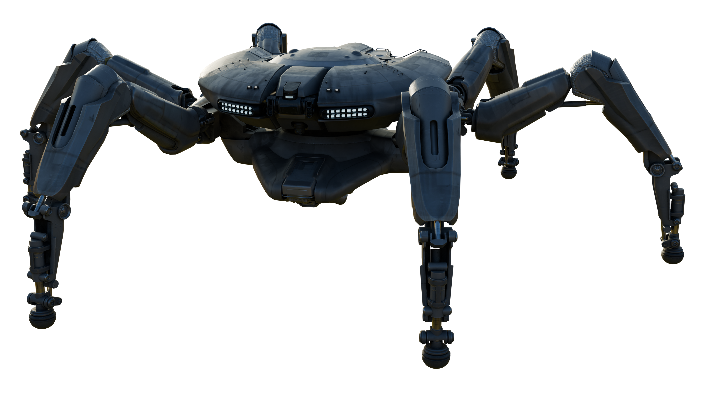
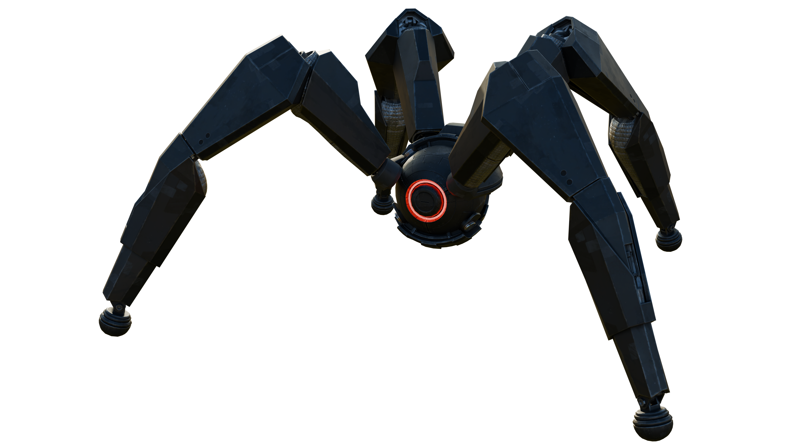
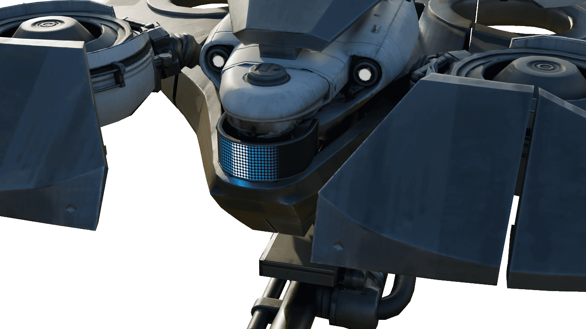
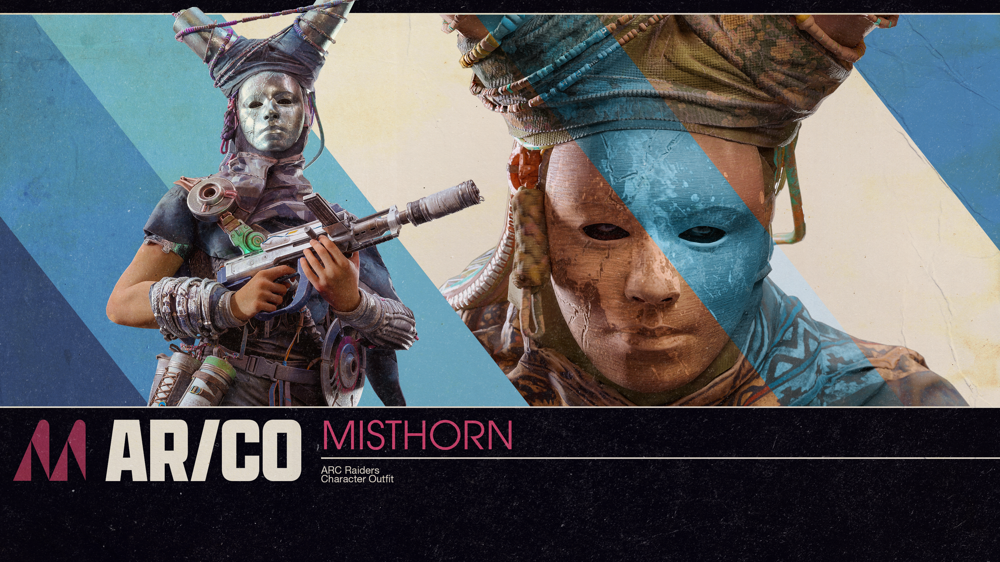

### [This fork is no longer maintained by AstroVal0 or Silarious]
 - Main contributors
	- [Teralix](https://github.com/Teralix42)
  	- [Silarious](https://watch.silarious.online)
	- [AstroVal0](https://github.com/Astroval0)
	
Objects folder is my own work now, for all uses of those assets please credit Teralix42.

The .blend files have packed textures and are for versions 5.0 and above, There may be issues opening them on lower versions.

The goal is to have easy accessible ARC Raiders assets for anyone to use.

### Last updated item images from 2.2.0

## NINJA RIPPER METHODE OUTDATED. USE [FMODEL](https://fmodel.app/) ON GAME PAKS USING [LATEST USMAP](Mappings/)

Join Blend raiders [Discord Server](https://discord.gg/8xZHEudWN2) for more information and help. More assets, paks and extracts on the [archive](https://drive.google.com/drive/folders/1BSm-QteBKxMn7CyHkg72xkPnjQRQJnJP?usp=sharing)

