# Bombardier

[ARC stats](README.md) · [Machine-readable data](arc_parts.json) · [Damage model](Damage_Model.md)

**Configured frame rule:** 2670 HP. **Internal class:** `C_ChonkPlatform_Mortar`.

Frame HP is a balancing rule, not the sum of every limb or plate. Part rules and damage propagation are separate. `—` means unknown or unassigned.

[Interactive Blender inspection model](Models/Bombardier.blend) · Native textures and inspector are packed into the file.

<a href="Renders/Bombardier/03_Part_Health_B.png">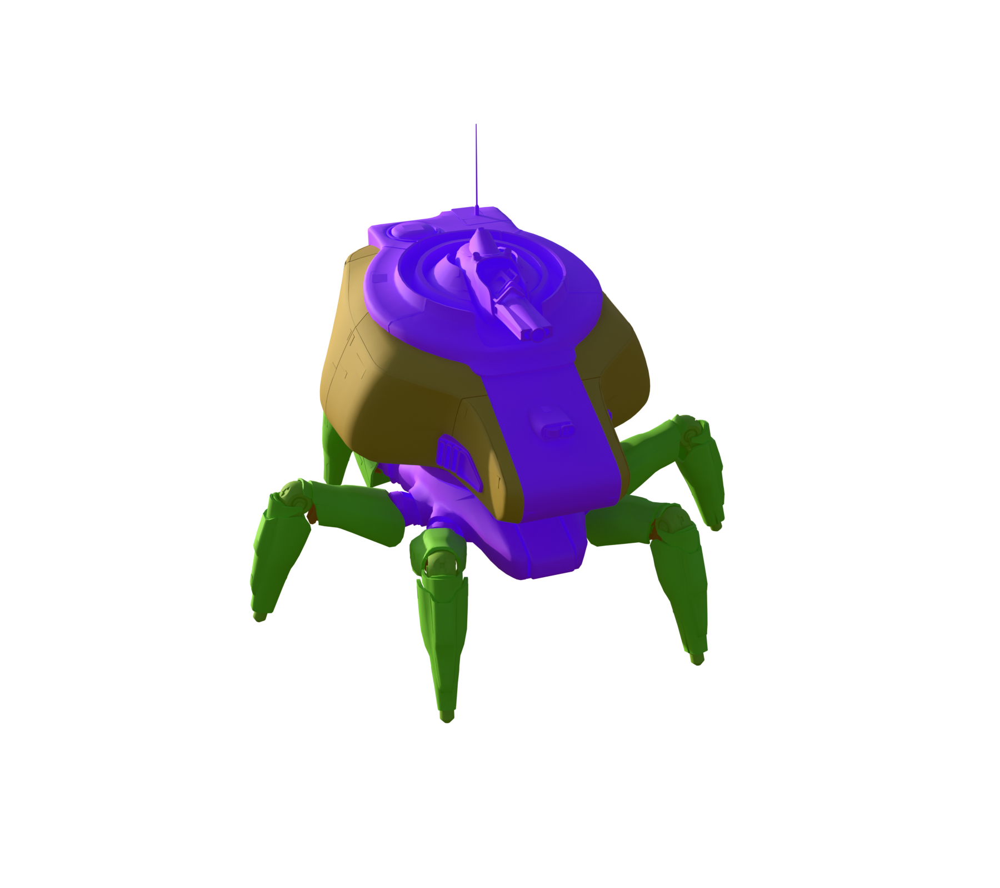</a>

All stat renders

**Original materials**

  <a href="Renders/Bombardier/01_Original_Materials_A.png">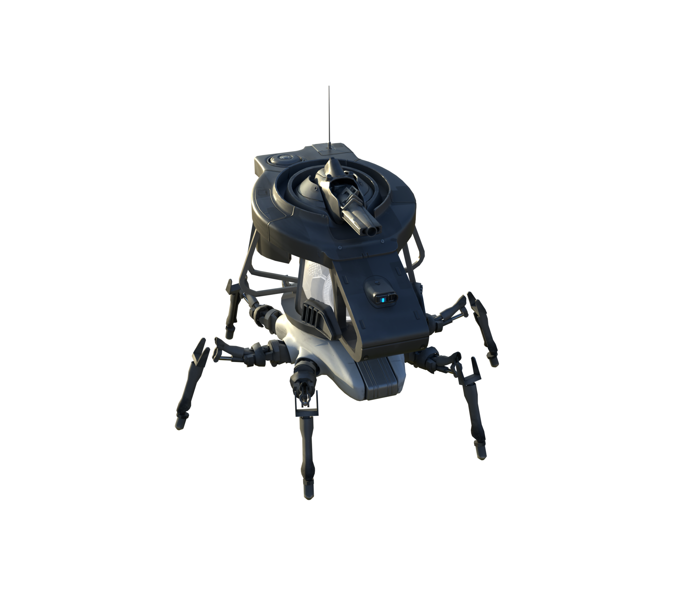</a>
  

**Part type**

  <a href="Renders/Bombardier/02_Part_Type_A.png">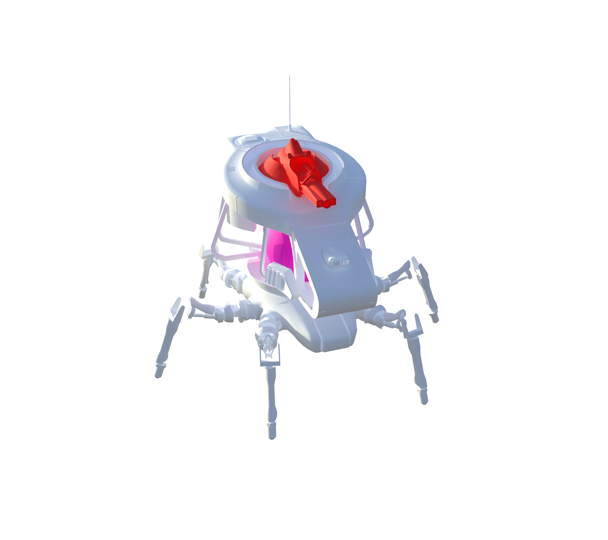</a>
  <a href="Renders/Bombardier/02_Part_Type_B.png">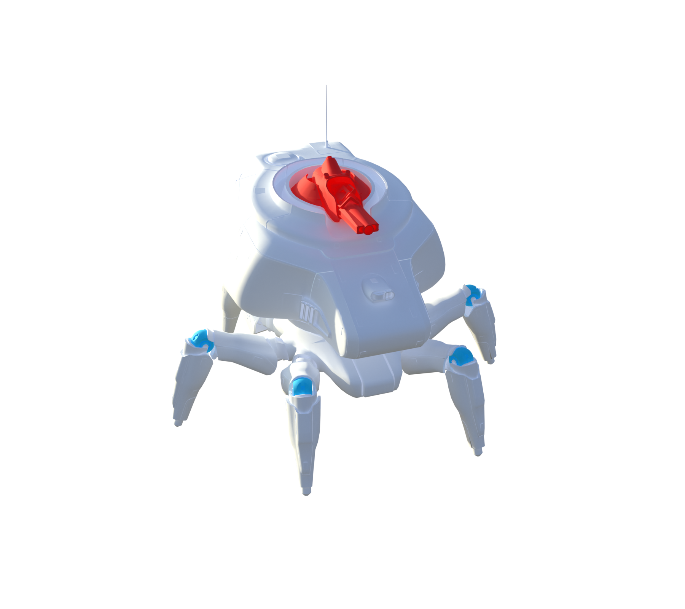</a>

**Part health**

  <a href="Renders/Bombardier/03_Part_Health_A.png">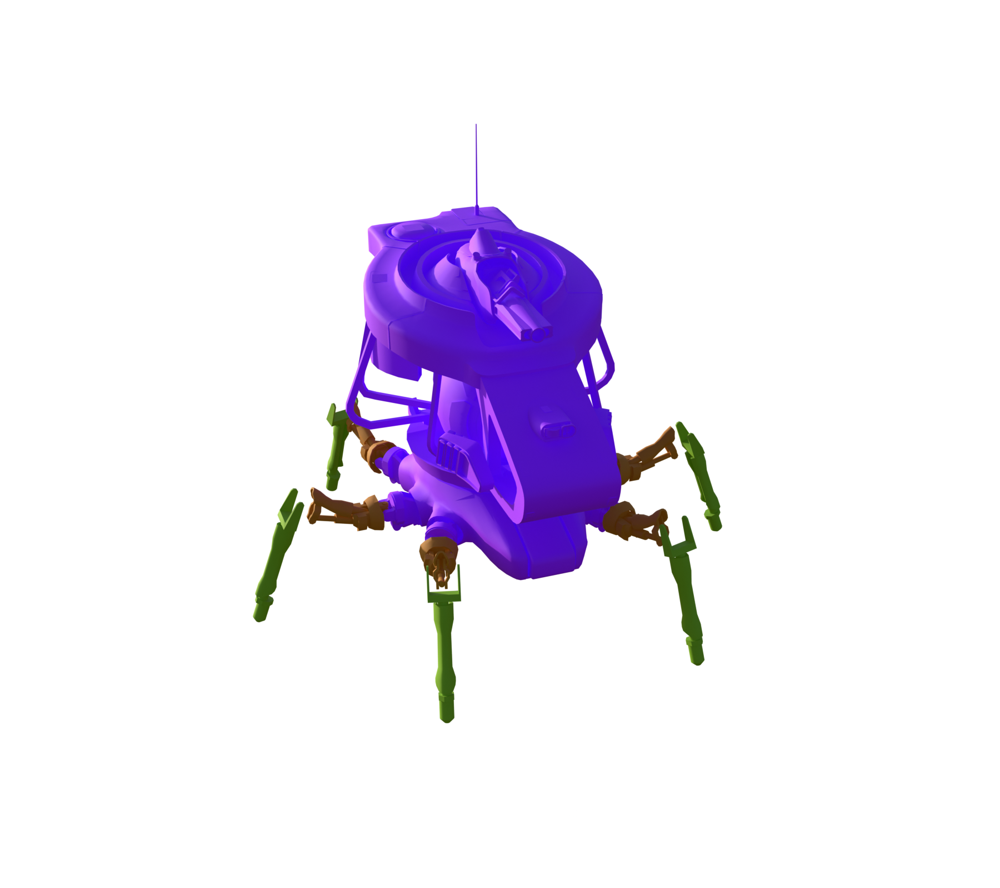</a>
  

**Break-off parts**

  <a href="Renders/Bombardier/04_Break_Off_A.png">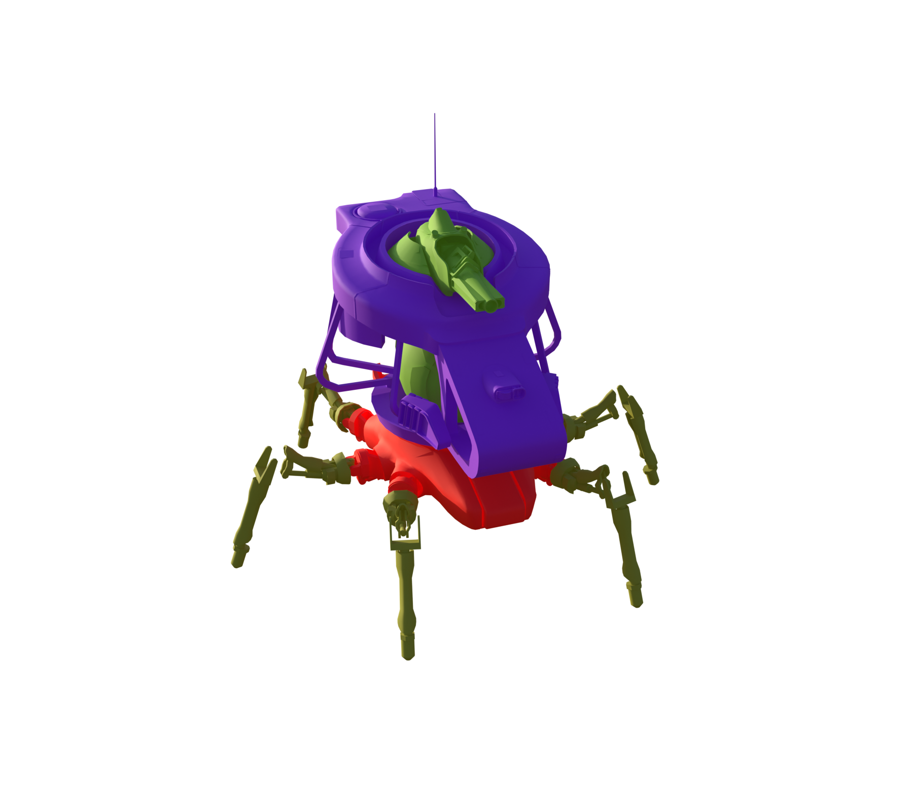</a>
  <a href="Renders/Bombardier/04_Break_Off_B.png">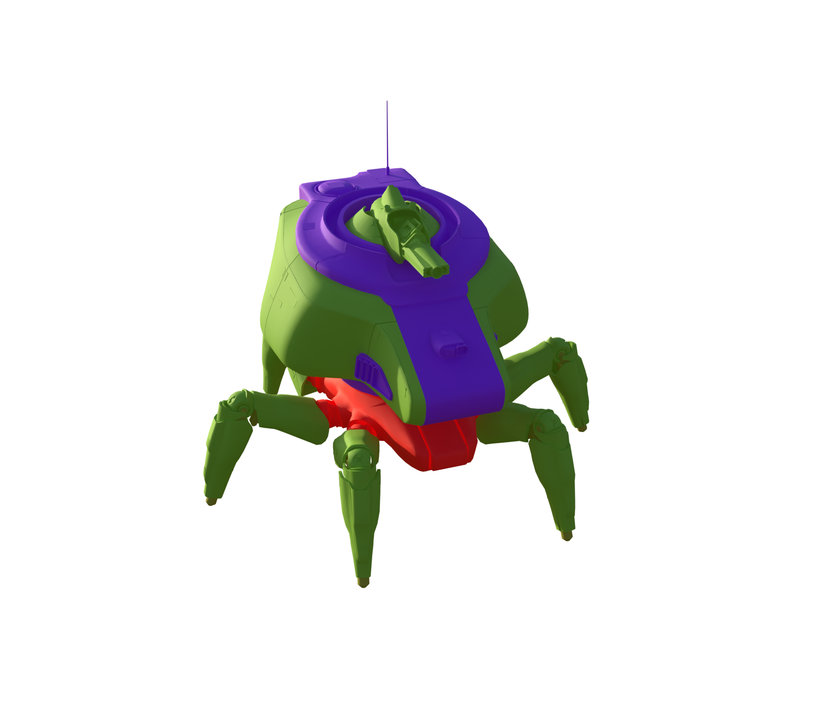</a>

**Scavenging**

  <a href="Renders/Bombardier/05_Scavenge_Interaction_A.png">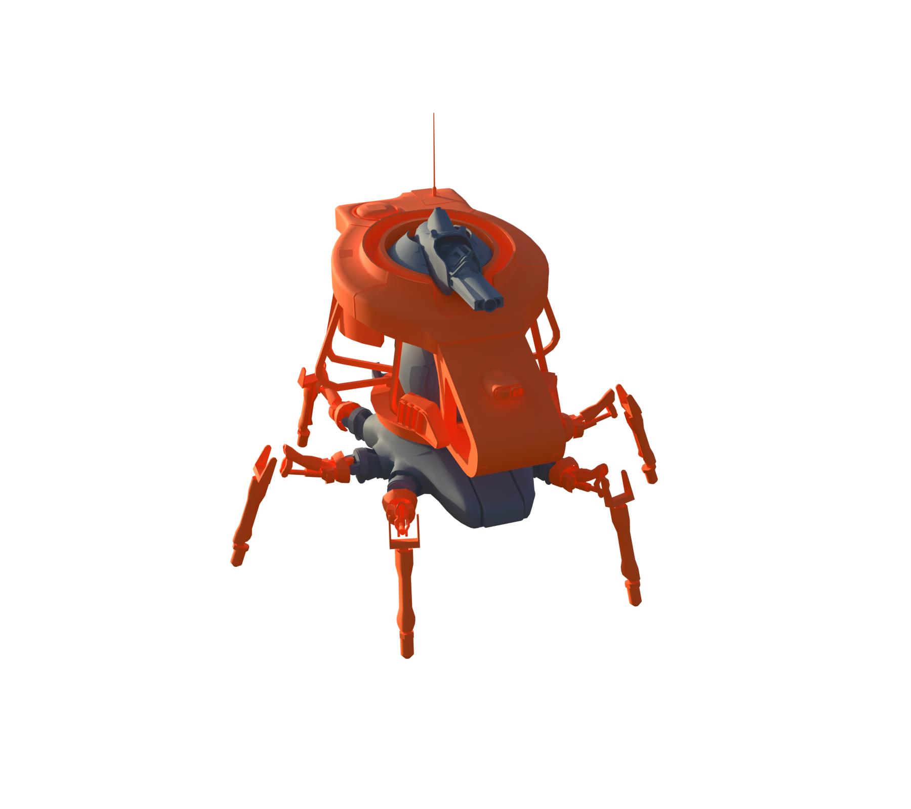</a>
  <a href="Renders/Bombardier/05_Scavenge_Interaction_B.png">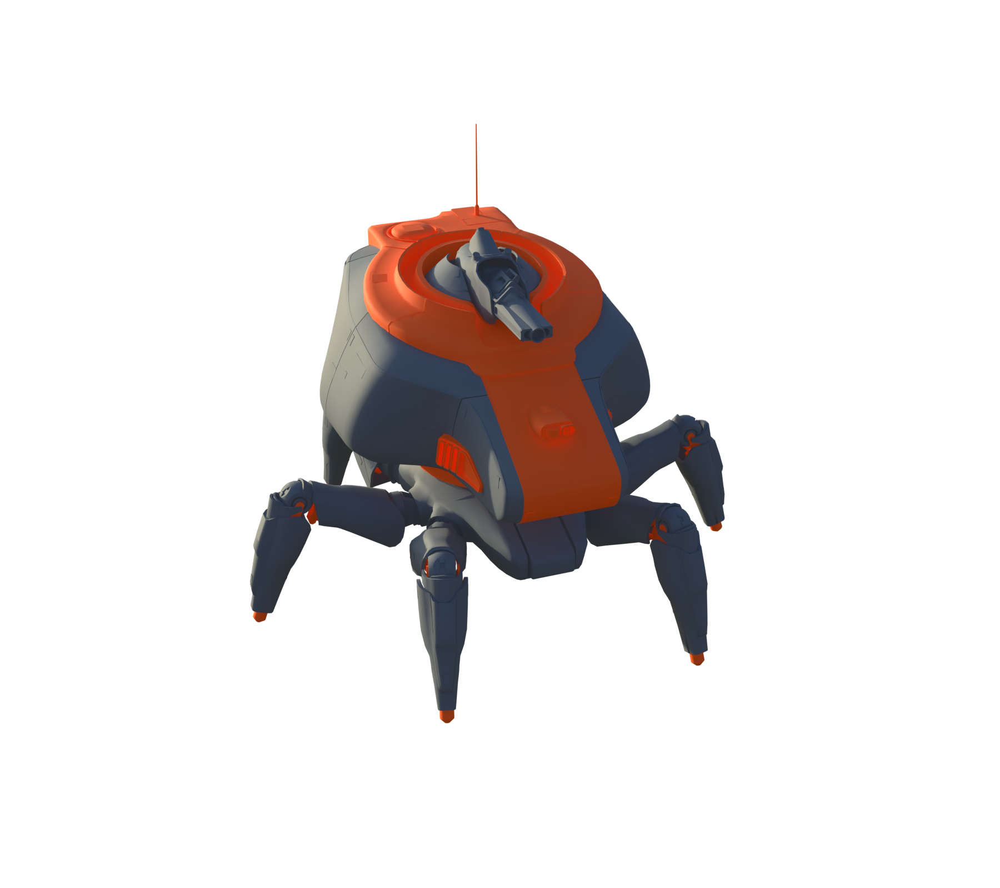</a>

**Damage targets**

  <a href="Renders/Bombardier/06_Damage_Targets_A.png">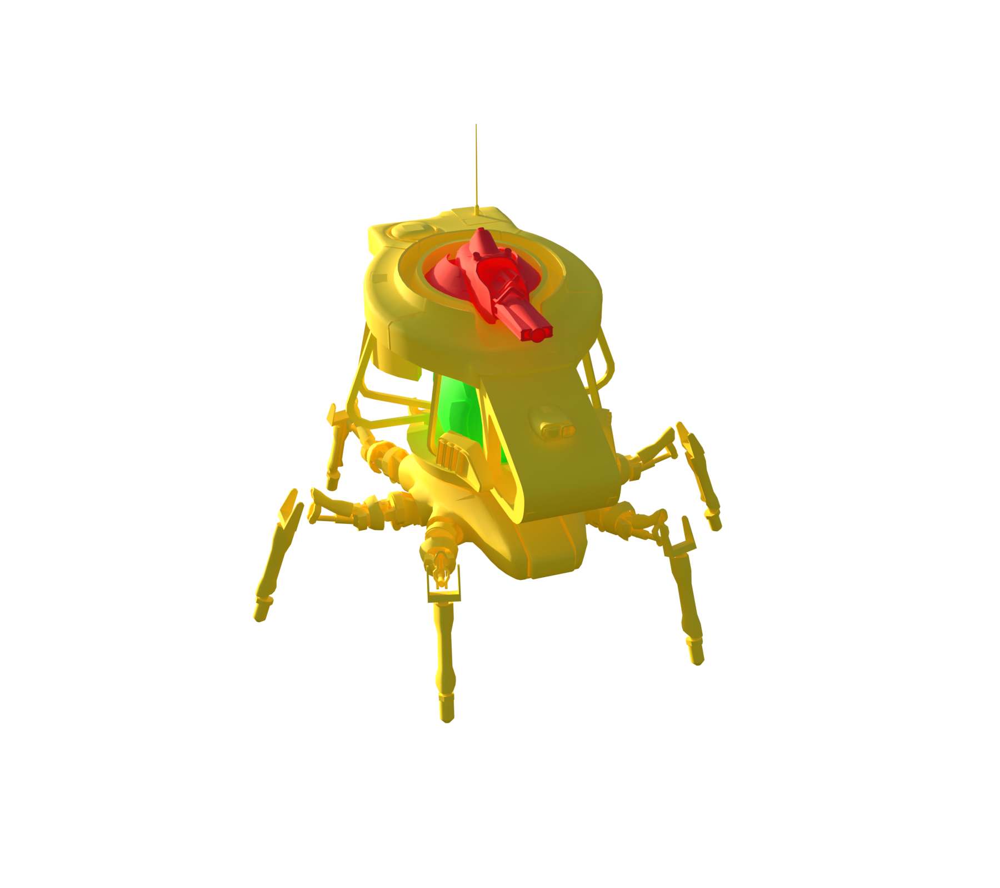</a>
  <a href="Renders/Bombardier/06_Damage_Targets_B.png">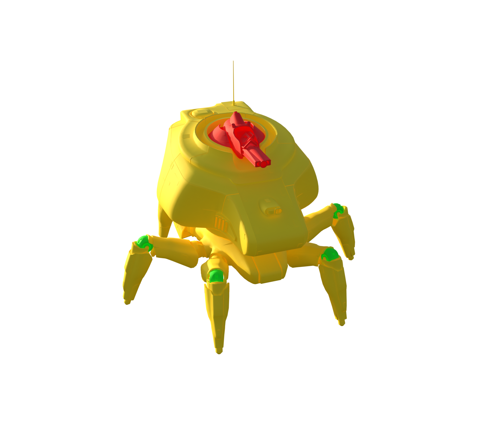</a>

### Weak and critical parts

| Part | Configured HP | Group | Baseline physical damage × |
| --- | --- | --- | --- |
| Core_01 | 5000 | Critical | 1.5 |
| Weakpoint_02 | 450 | WeakPoint | 1.5 |
| Weakpoint_01_L_01 | 180 | WeakPoint | 1.5 |
| Weakpoint_01_L_02 | 180 | WeakPoint | 1.5 |
| Weakpoint_01_L_03 | 180 | WeakPoint | 1.5 |
| Weakpoint_01_R_01 | 180 | WeakPoint | 1.5 |
| Weakpoint_01_R_02 | 180 | WeakPoint | 1.5 |
| Weakpoint_01_R_03 | 180 | WeakPoint | 1.5 |

### Every named part

These records also include sockets, bones, and proxy components; they are not all independent damageable hitboxes. The weapon’s separate ARC armor and weak-point multipliers still apply where indicated in JSON.

| Part | Configured HP | Resistance group | Physical damage × | Health rules |
| --- | --- | --- | --- | --- |
| Muzzle | — | — | — |  |
| Sensor | — | — | — |  |
| Body_01 | 2670 | Normal | 1 | 0 |
| HeadPivot | 1e+07 | Normal | 1 | 9 |
| Head_01 | 10000 | Normal | 1 | 4 |
| Armor_01_L_01 | 250 | Normal | 1 | 8 |
| Armor_01_R_01 | 250 | Normal | 1 | 8 |
| Armor_02_L_01 | 250 | Normal | 1 | 8 |
| Armor_02_R_01 | 250 | Normal | 1 | 8 |
| Armor_03_L_01 | 250 | Normal | 1 | 8 |
| Armor_03_R_01 | 250 | Normal | 1 | 8 |
| Armor_04_L_01 | 250 | Normal | 1 | 8 |
| Armor_04_R_01 | 250 | Normal | 1 | 8 |
| Core_01 | 5000 | Critical | 1.5 | 10 |
| Insides_01 | 150 | Fragile | 1.2 | 11 |
| Insides_02_C_01 | 150 | Fragile | 1.2 | 13 |
| Weakpoint_02 | 450 | WeakPoint | 1.5 | 1 |
| Weapon_Pivot_01 | 10000 | Sturdy | 0.4 | 6 |
| Weapon_01_Barrel_01 | 10000 | Sturdy | 0.4 | 5 |
| UpperLeg_01_L_01 | 280 | Normal | 1 | 2 |
| LowerLeg_01_L_01 | 180 | Normal | 1 | 3 |
| LowerLeg_01_Armor_01_L_01 | 150 | Normal | 1 | 12 |
| Foot_L_01 | — | Normal | 1 |  |
| UpperLeg_01_Armor_01_L_01 | 150 | Normal | 1 | 12 |
| Weakpoint_01_L_01 | 180 | WeakPoint | 1.5 | 7 |
| UpperLeg_01_L_02 | 280 | Normal | 1 | 2 |
| LowerLeg_01_L_02 | 180 | Normal | 1 | 3 |
| LowerLeg_01_Armor_01_L_02 | 150 | Normal | 1 | 12 |
| Foot_L_02 | — | Normal | 1 |  |
| UpperLeg_01_Armor_01_L_02 | 150 | Normal | 1 | 12 |
| Weakpoint_01_L_02 | 180 | WeakPoint | 1.5 | 7 |
| UpperLeg_01_L_03 | 280 | Normal | 1 | 2 |
| LowerLeg_01_L_03 | 180 | Normal | 1 | 3 |
| LowerLeg_01_Armor_01_L_03 | 150 | Normal | 1 | 12 |
| Foot_L_03 | — | Normal | 1 |  |
| UpperLeg_01_Armor_01_L_03 | 150 | Normal | 1 | 12 |
| Weakpoint_01_L_03 | 180 | WeakPoint | 1.5 | 7 |
| UpperLeg_01_R_01 | 280 | Normal | 1 | 2 |
| LowerLeg_01_R_01 | 180 | Normal | 1 | 3 |
| LowerLeg_01_Armor_01_R_01 | 150 | Normal | 1 | 12 |
| Foot_R_01 | — | Normal | 1 |  |
| UpperLeg_01_Armor_01_R_01 | 150 | Normal | 1 | 12 |
| Weakpoint_01_R_01 | 180 | WeakPoint | 1.5 | 7 |
| UpperLeg_01_R_02 | 280 | Normal | 1 | 2 |
| LowerLeg_01_R_02 | 180 | Normal | 1 | 3 |
| LowerLeg_01_Armor_01_R_02 | 150 | Normal | 1 | 12 |
| Foot_R_02 | — | Normal | 1 |  |
| UpperLeg_01_Armor_01_R_02 | 150 | Normal | 1 | 12 |
| Weakpoint_01_R_02 | 180 | WeakPoint | 1.5 | 7 |
| UpperLeg_01_R_03 | 280 | Normal | 1 | 2 |
| LowerLeg_01_R_03 | 180 | Normal | 1 | 3 |
| LowerLeg_01_Armor_01_R_03 | 150 | Normal | 1 | 12 |
| Foot_R_03 | — | Normal | 1 |  |
| UpperLeg_01_Armor_01_R_03 | 150 | Normal | 1 | 12 |
| Weakpoint_01_R_03 | 180 | WeakPoint | 1.5 | 7 |

### Exact health assignment rules

| Rule | Tag query | HP | Matched parts |
| --- | --- | --- | --- |
| 0 | ID.Frame | 2670 | Body_01 |
| 1 | Group.Weakpoint | 450 | Weakpoint_02 |
| 2 | ALL(ID.Leg, Group.Relative.Upper) | 280 | UpperLeg_01_L_01, UpperLeg_01_L_02, UpperLeg_01_L_03, UpperLeg_01_R_01, UpperLeg_01_R_02, UpperLeg_01_R_03 |
| 3 | ALL(ID.Leg, Group.Relative.Lower) | 180 | LowerLeg_01_L_01, LowerLeg_01_L_02, LowerLeg_01_L_03, LowerLeg_01_R_01, LowerLeg_01_R_02, LowerLeg_01_R_03 |
| 4 | ID.Head | 10000 | Head_01 |
| 5 | ID.Turret | 10000 | Weapon_01_Barrel_01 |
| 6 | ID.Arm.Front | 10000 | Weapon_Pivot_01 |
| 7 | ANY(ID.Joint) | 180 | Weakpoint_01_L_01, Weakpoint_01_L_02, Weakpoint_01_L_03, Weakpoint_01_R_01, Weakpoint_01_R_02, Weakpoint_01_R_03 |
| 8 | HealthGroup.Base | 250 | Armor_01_L_01, Armor_01_R_01, Armor_02_L_01, Armor_02_R_01, Armor_03_L_01, Armor_03_R_01, Armor_04_L_01, Armor_04_R_01 |
| 9 | ANY(ID.HeadPivot) | 1e+07 | HeadPivot |
| 10 | ID.Core | 5000 | Core_01 |
| 11 | HealthGroup.SubParts.01 | 150 | Insides_01 |
| 12 | HealthGroup.Legs | 150 | LowerLeg_01_Armor_01_L_01, UpperLeg_01_Armor_01_L_01, LowerLeg_01_Armor_01_L_02, UpperLeg_01_Armor_01_L_02, LowerLeg_01_Armor_01_L_03, UpperLeg_01_Armor_01_L_03, LowerLeg_01_Armor_01_R_01, UpperLeg_01_Armor_01_R_01, LowerLeg_01_Armor_01_R_02, UpperLeg_01_Armor_01_R_02, LowerLeg_01_Armor_01_R_03, UpperLeg_01_Armor_01_R_03 |
| 13 | HealthGroup.SubParts.02 | 150 | Insides_02_C_01 |

Actual game source files

- [Content/Pioneer/Enemies/ChonkMortar/ChonkPlatform/C_ChonkPlatform_Mortar.json](../Sources/PioneerGame/Content/Pioneer/Enemies/ChonkMortar/ChonkPlatform/C_ChonkPlatform_Mortar.json)
- [Content/Pioneer/Enemies/ChonkMortar/ChonkPlatform/DataAssets/CSSM_ChonkMortar_01.json](../Sources/PioneerGame/Content/Pioneer/Enemies/ChonkMortar/ChonkPlatform/DataAssets/CSSM_ChonkMortar_01.json)
- [Content/Pioneer/Enemies/ChonkMortar/ChonkPlatform/DataAssets/DA_Balancing_C_ChonkPlatform_Mortar.json](../Sources/PioneerGame/Content/Pioneer/Enemies/ChonkMortar/ChonkPlatform/DataAssets/DA_Balancing_C_ChonkPlatform_Mortar.json)
- [Content/Pioneer/Enemies/ChonkMortar/ChonkPlatform/DataAssets/DA_EnemyMetaData_ChonkMortar.json](../Sources/PioneerGame/Content/Pioneer/Enemies/ChonkMortar/ChonkPlatform/DataAssets/DA_EnemyMetaData_ChonkMortar.json)
- [Content/Pioneer/Enemies/ChonkMortar/ChonkPlatform/DataAssets/DA_EnemyType_ChonkPlatform_Mortar.json](../Sources/PioneerGame/Content/Pioneer/Enemies/ChonkMortar/ChonkPlatform/DataAssets/DA_EnemyType_ChonkPlatform_Mortar.json)

