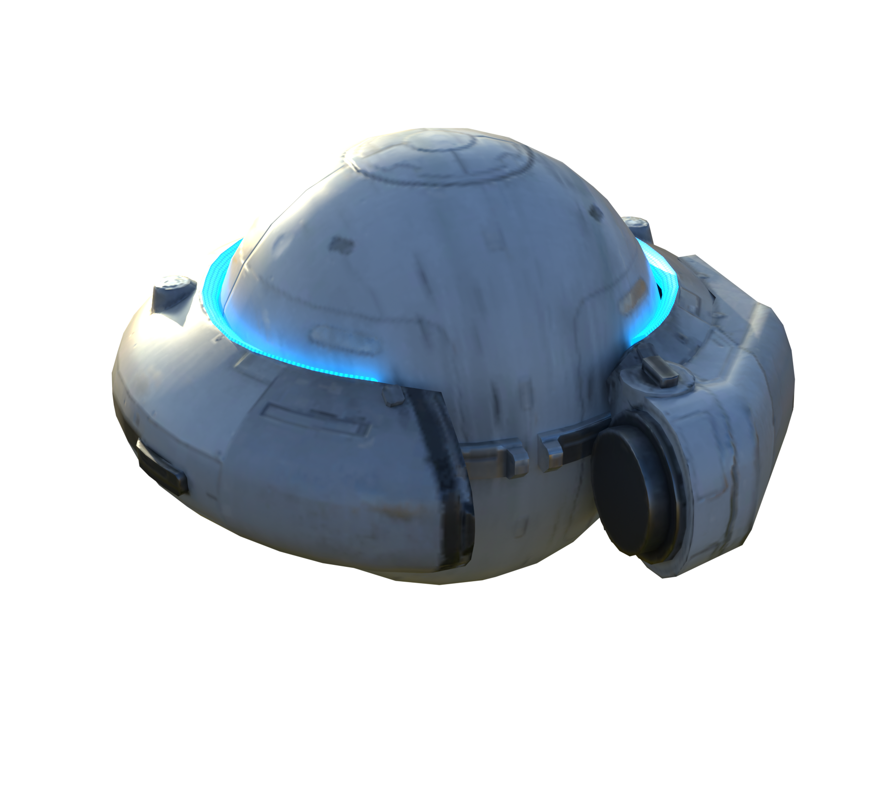
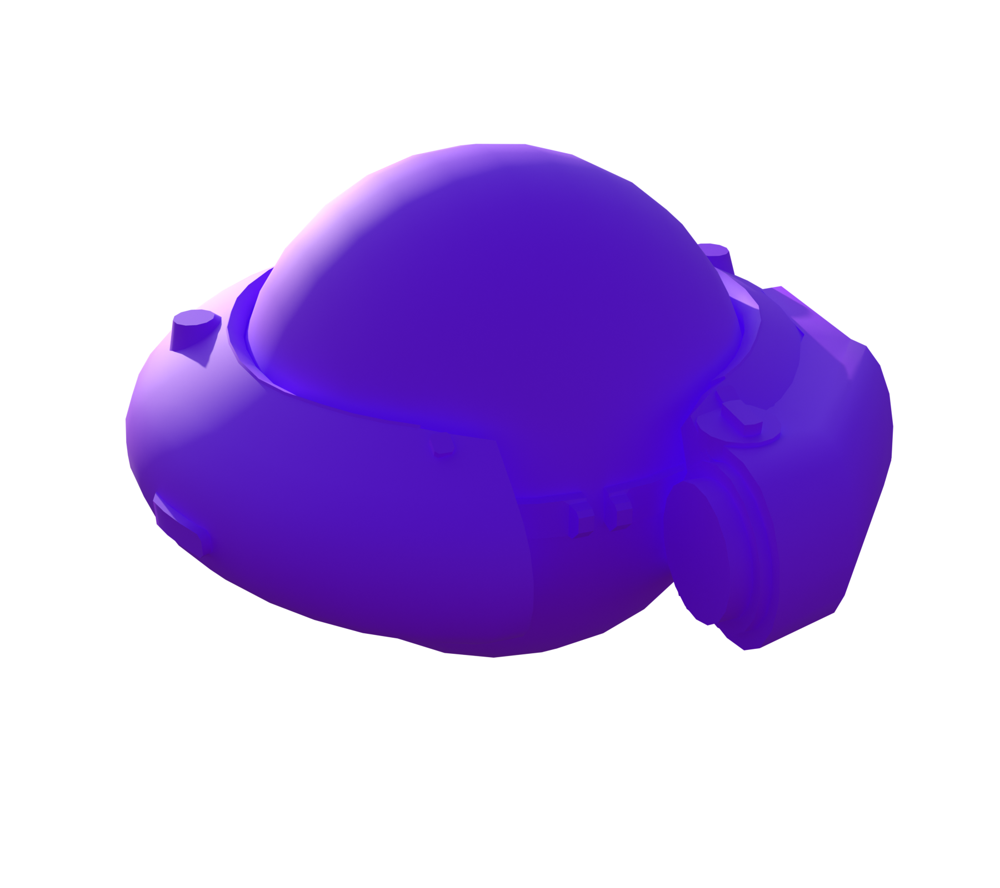
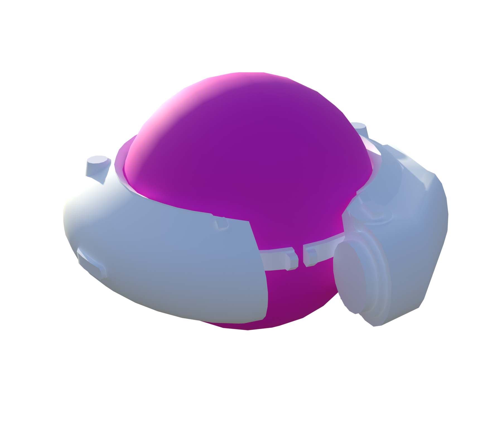
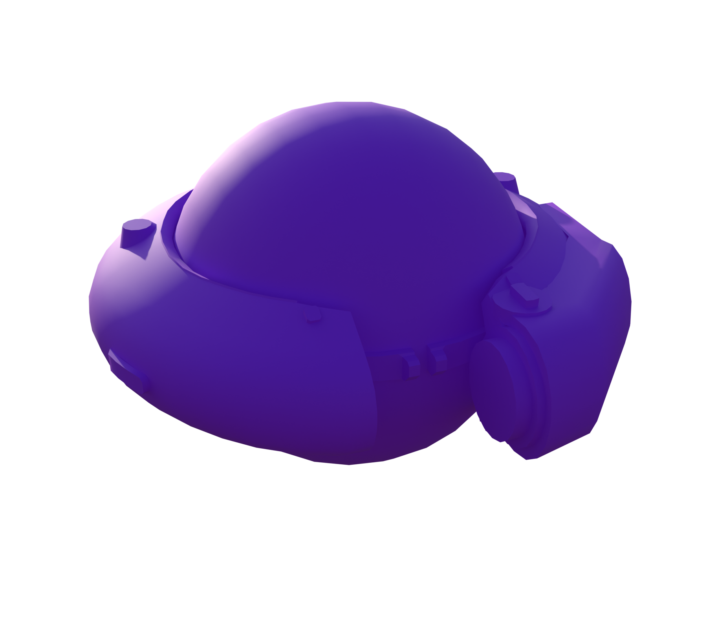
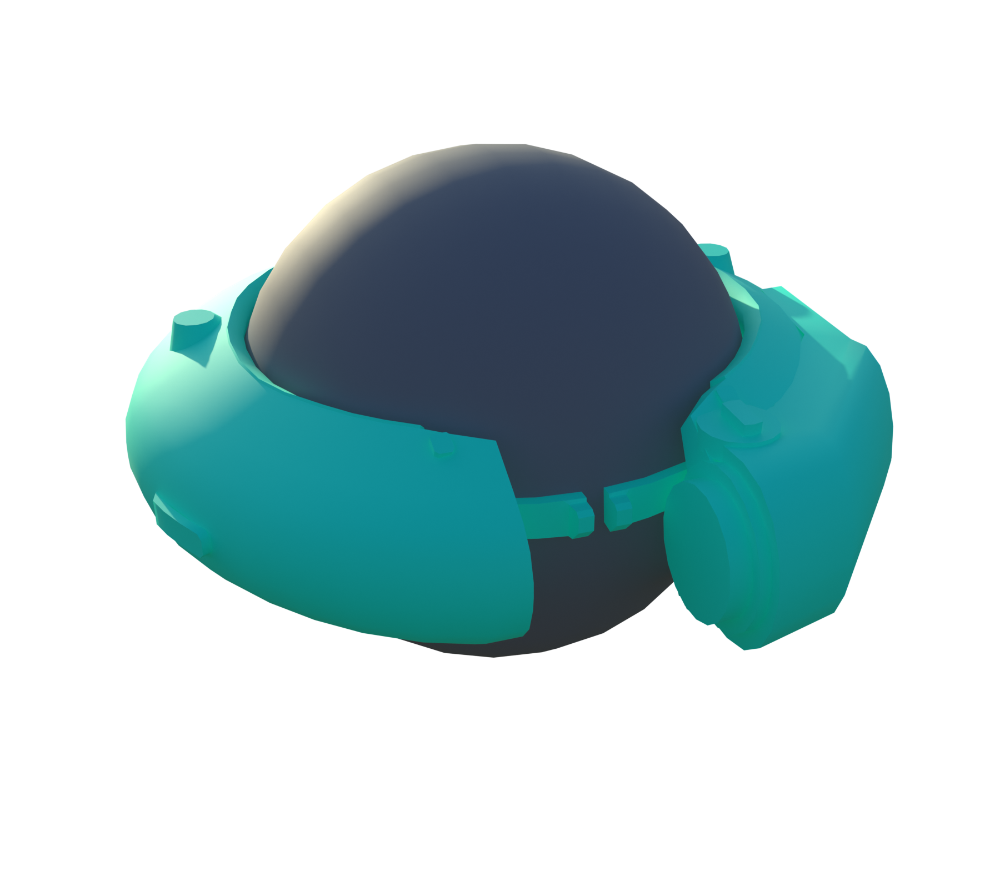
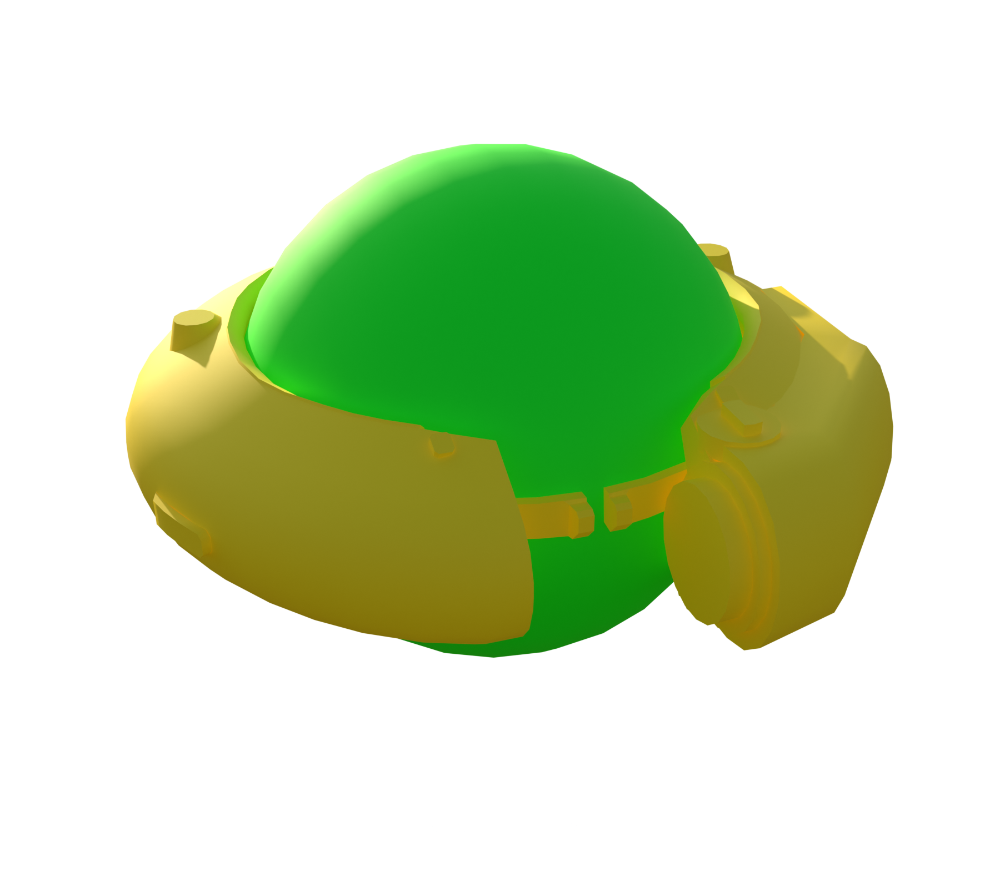

# Pop

[ARC stats](README.md) · [Machine-readable data](arc_parts.json) · [Damage model](Damage_Model.md)

**Configured frame rule:** 20 HP. **Internal class:** `C_RollBot_Pop`.

Frame HP is a balancing rule, not the sum of every limb or plate. Part rules and damage propagation are separate. `—` means unknown or unassigned.

[Interactive Blender inspection model](Models/Pop.blend) · Native textures and inspector are packed into the file.

### Layers and views

| Layer | Visible structure |
| --- | --- |
| A | Full model |

All six views, including inner layers

**A: Full model**

### Weak and critical parts

| Part | Configured HP | Group | Baseline physical damage × |
| --- | --- | --- | --- |
| Frame_01 | 20 | Critical | 1.5 |

### Every named part

These records also include sockets, bones, and proxy components; they are not all independent damageable hitboxes. The weapon’s separate ARC armor and weak-point multipliers still apply where indicated in JSON.

| Part | Configured HP | Resistance group | Physical damage × | Health rules |
| --- | --- | --- | --- | --- |
| DummyParent_Root | 1000 | Normal | 1 | 1 |
| Frame_01 | 20 | Critical | 1.5 | 0 |
| FrameCenterAxis | — | Normal | 1 |  |
| Hull_01 | 20 | Normal | 1 | 4 |
| PerceptionPart | — | Normal | 1 |  |

### Exact health assignment rules

| Rule | Tag query | HP | Matched parts |
| --- | --- | --- | --- |
| 0 | ID.Frame | 20 | Frame_01 |
| 1 | ID.Rollbot.Root | 1000 | DummyParent_Root |
| 2 | ID.Flap | 10 |  |
| 3 | ANY(ID.Arm) | 20 |  |
| 4 | ID.Head | 20 | Hull_01 |

Some actor/style sources have partial-decoding warnings; the balancing health tables parsed separately. The JSON retains the warnings and recovered destruction settings.

Actual game source files

- [Content/Pioneer/Enemies/Pop/Pop/C_RollBot_Pop.json](../Sources/PioneerGame/Content/Pioneer/Enemies/Pop/Pop/C_RollBot_Pop.json)
- [Content/Pioneer/Enemies/Pop/Pop/DataAssets/CSSC_RollBot_Pop.json](../Sources/PioneerGame/Content/Pioneer/Enemies/Pop/Pop/DataAssets/CSSC_RollBot_Pop.json)
- [Content/Pioneer/Enemies/Pop/Pop/DataAssets/DA_Balancing_C_RollBot_Pop.json](../Sources/PioneerGame/Content/Pioneer/Enemies/Pop/Pop/DataAssets/DA_Balancing_C_RollBot_Pop.json)
- [Content/Pioneer/Enemies/Pop/Pop/DataAssets/DA_EnemyMetaData_RollBot_Pop.json](../Sources/PioneerGame/Content/Pioneer/Enemies/Pop/Pop/DataAssets/DA_EnemyMetaData_RollBot_Pop.json)
- [Content/Pioneer/Enemies/Pop/Pop/DataAssets/DA_EnemyType_RollBot_Pop.json](../Sources/PioneerGame/Content/Pioneer/Enemies/Pop/Pop/DataAssets/DA_EnemyType_RollBot_Pop.json)

