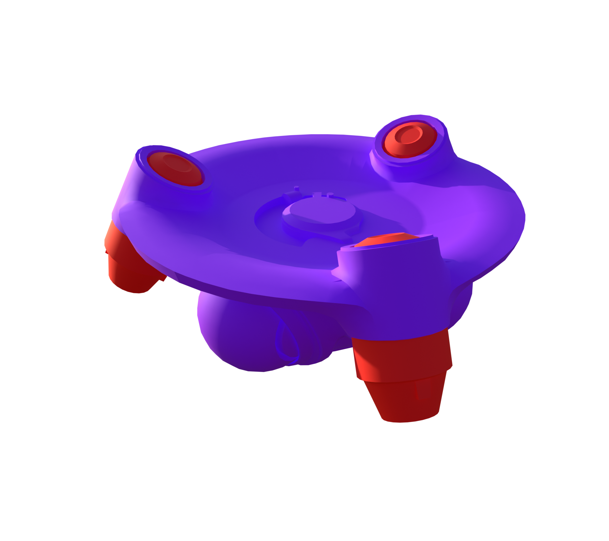
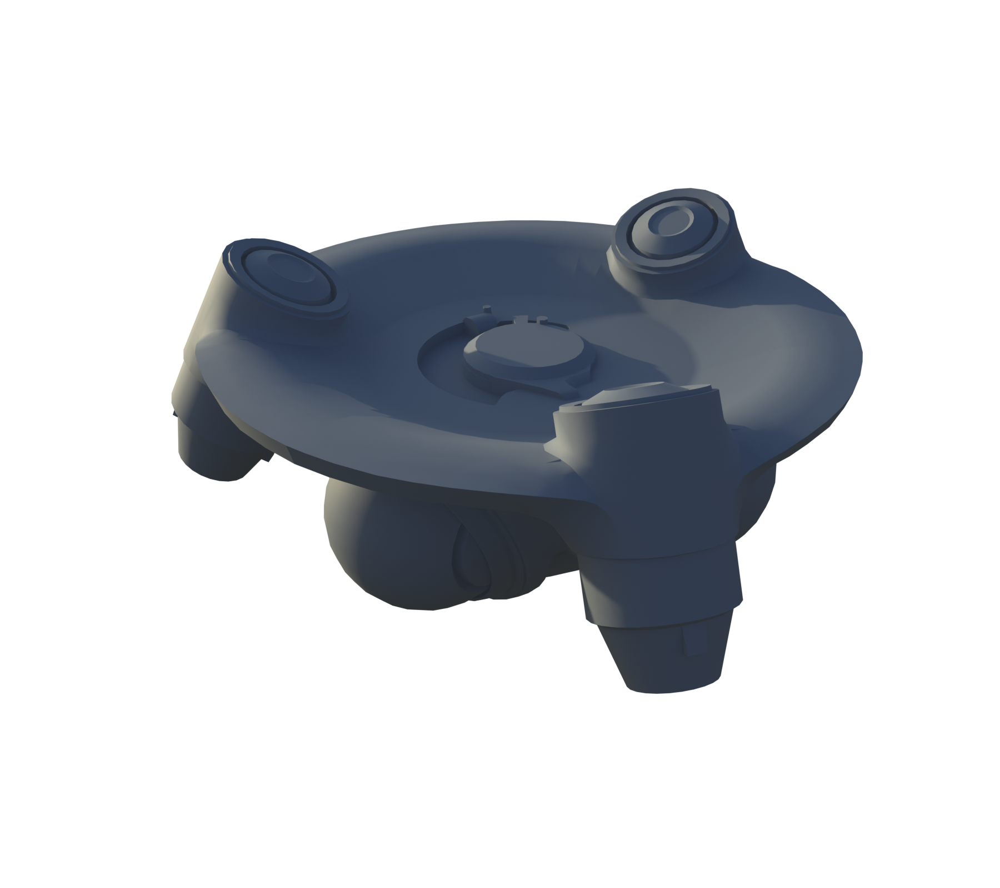
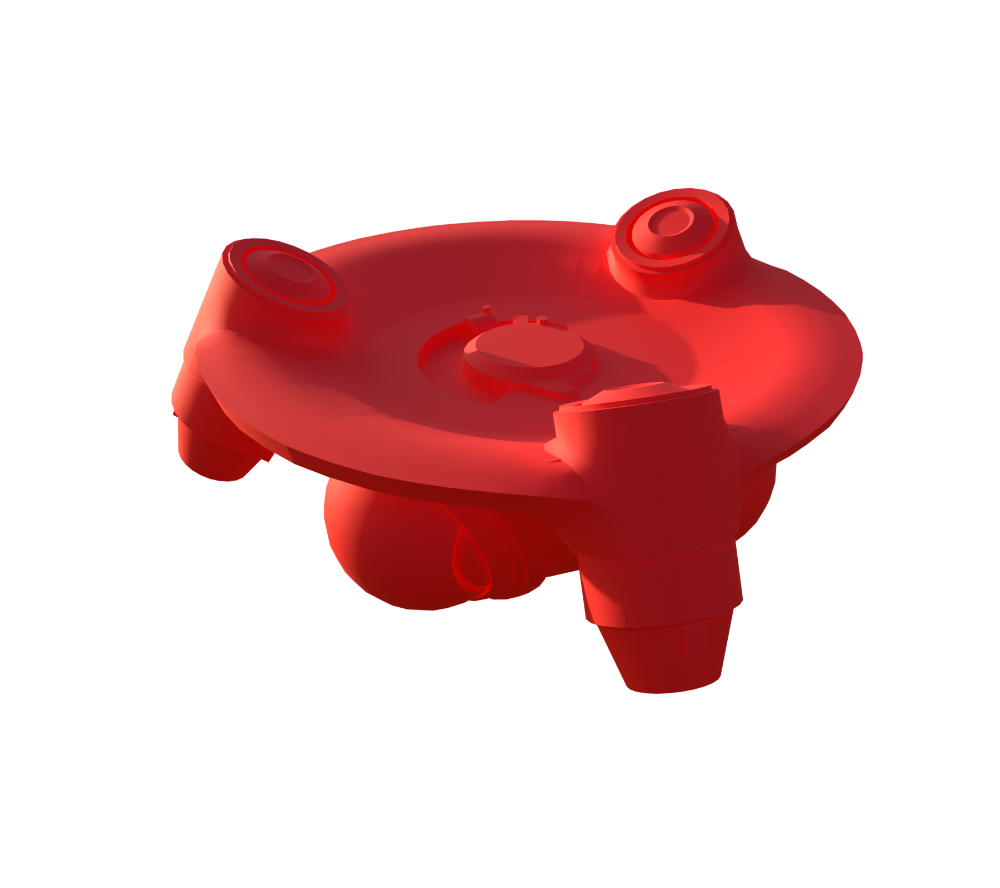

# ARC Reclaimer

[ARC stats](README.md) · [Machine-readable data](arc_parts.json) · [Damage model](Damage_Model.md)

**Configured frame rule:** 830 HP. **Internal class:** `C_Courier`.

Frame HP is a balancing rule, not the sum of every limb or plate. Part rules and damage propagation are separate. `—` means unknown or unassigned.

[Interactive Blender inspection model](Models/Reclaimer.blend) · Native textures and inspector are packed into the file.

### Layers and views

| Layer | Visible structure |
| --- | --- |
| A | Full model |

All six views, including inner layers

**A: Full model**

### Weak and critical parts

No explicit WeakPoint/Critical resistance assignment was recovered for this profile. This does not imply invulnerability.

### Every named part

These records also include sockets, bones, and proxy components; they are not all independent damageable hitboxes. The weapon’s separate ARC armor and weak-point multipliers still apply where indicated in JSON.

| Part | Configured HP | Resistance group | Physical damage × | Health rules |
| --- | --- | --- | --- | --- |
| ScannerSocket | — | — | — |  |
| SmallThruster_01 | — | — | — |  |
| SmallThruster_02 | — | — | — |  |
| SmallThruster_03 | — | — | — |  |
| Main | 830 | Sturdy | 0.4 | 0 |
| Hatch_01 | 10000 | Sturdy | 0.4 | 2 |
| Thruster_C_01 | 350 | Sturdy | 0.4 | 1 |
| Thruster_L_02 | 350 | Sturdy | 0.4 | 1 |
| Thruster_R_02 | 350 | Sturdy | 0.4 | 1 |
| ScannerStyle | — | — | — |  |

### Exact health assignment rules

| Rule | Tag query | HP | Matched parts |
| --- | --- | --- | --- |
| 0 | ANY(ID.Frame) | 830 | Main |
| 1 | ANY(ID.Thruster) | 350 | Thruster_C_01, Thruster_L_02, Thruster_R_02 |
| 2 | ANY(ID.Armor.Heavy) | 10000 | Hatch_01 |

Actual game source files

- [Content/Pioneer/Enemies/Courier/Art/CSSC_Courier.json](../Sources/PioneerGame/Content/Pioneer/Enemies/Courier/Art/CSSC_Courier.json)
- [Content/Pioneer/Enemies/Courier/CS_Courier.json](../Sources/PioneerGame/Content/Pioneer/Enemies/Courier/CS_Courier.json)
- [Content/Pioneer/Enemies/Courier/C_Courier.json](../Sources/PioneerGame/Content/Pioneer/Enemies/Courier/C_Courier.json)
- [Content/Pioneer/Enemies/Courier/Capabilities/GA_ShoveOffFrigate.json](../Sources/PioneerGame/Content/Pioneer/Enemies/Courier/Capabilities/GA_ShoveOffFrigate.json)
- [Content/Pioneer/Enemies/Courier/DataAssets/DA_Balancing_C_Courier.json](../Sources/PioneerGame/Content/Pioneer/Enemies/Courier/DataAssets/DA_Balancing_C_Courier.json)
- [Content/Pioneer/Enemies/Courier/DataAssets/DA_EnemyMetaData_Courier.json](../Sources/PioneerGame/Content/Pioneer/Enemies/Courier/DataAssets/DA_EnemyMetaData_Courier.json)
- [Content/Pioneer/Enemies/Courier/DataAssets/DA_EnemyType_Courier.json](../Sources/PioneerGame/Content/Pioneer/Enemies/Courier/DataAssets/DA_EnemyType_Courier.json)

