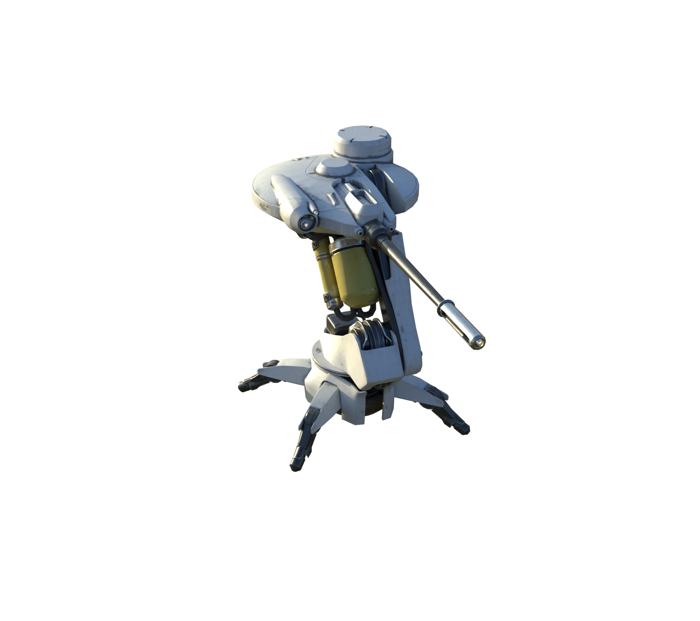
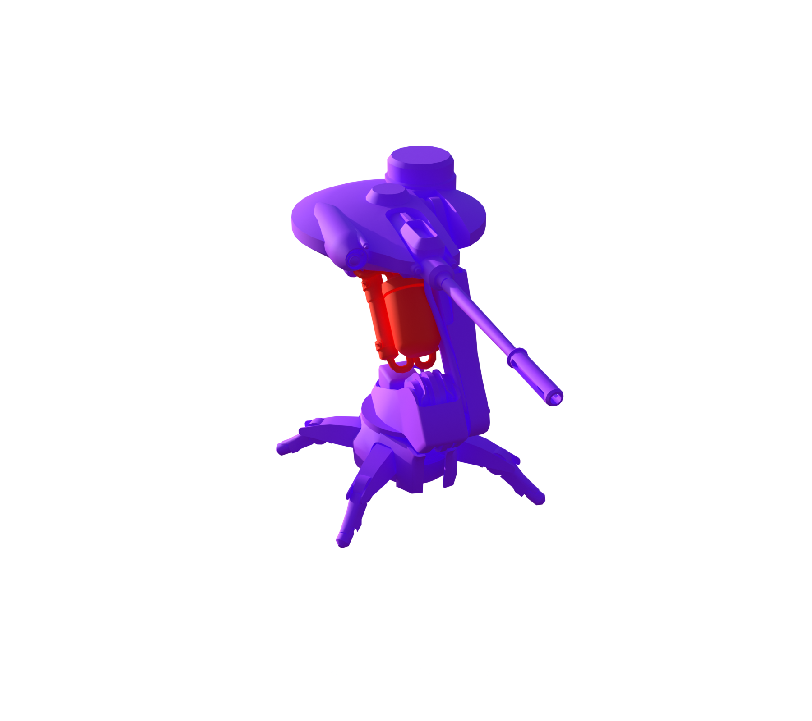
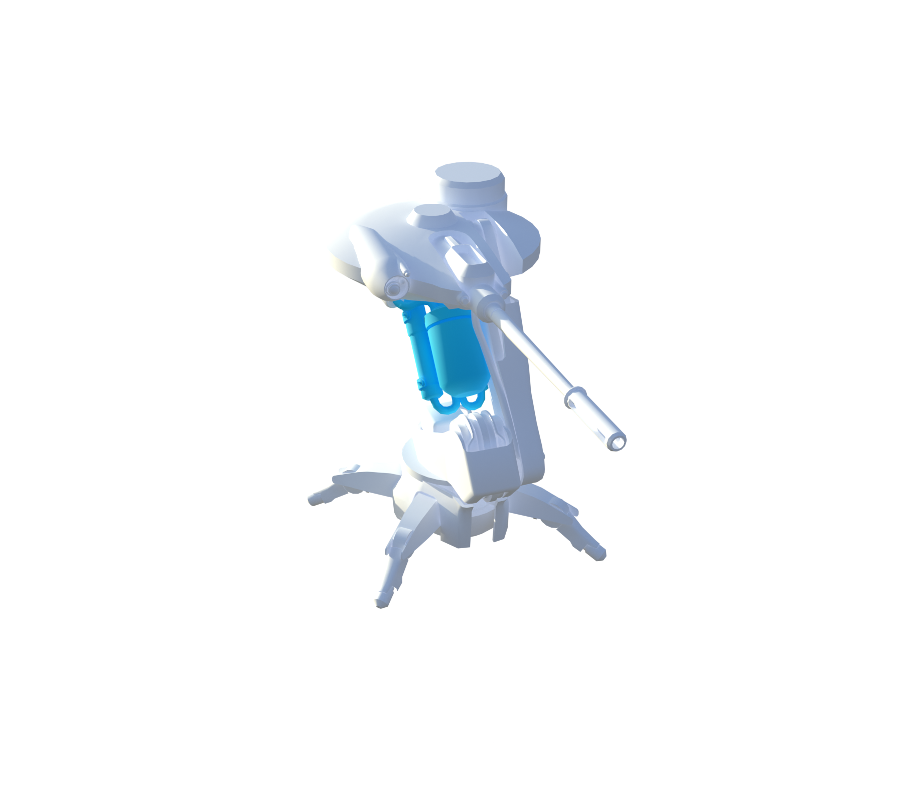
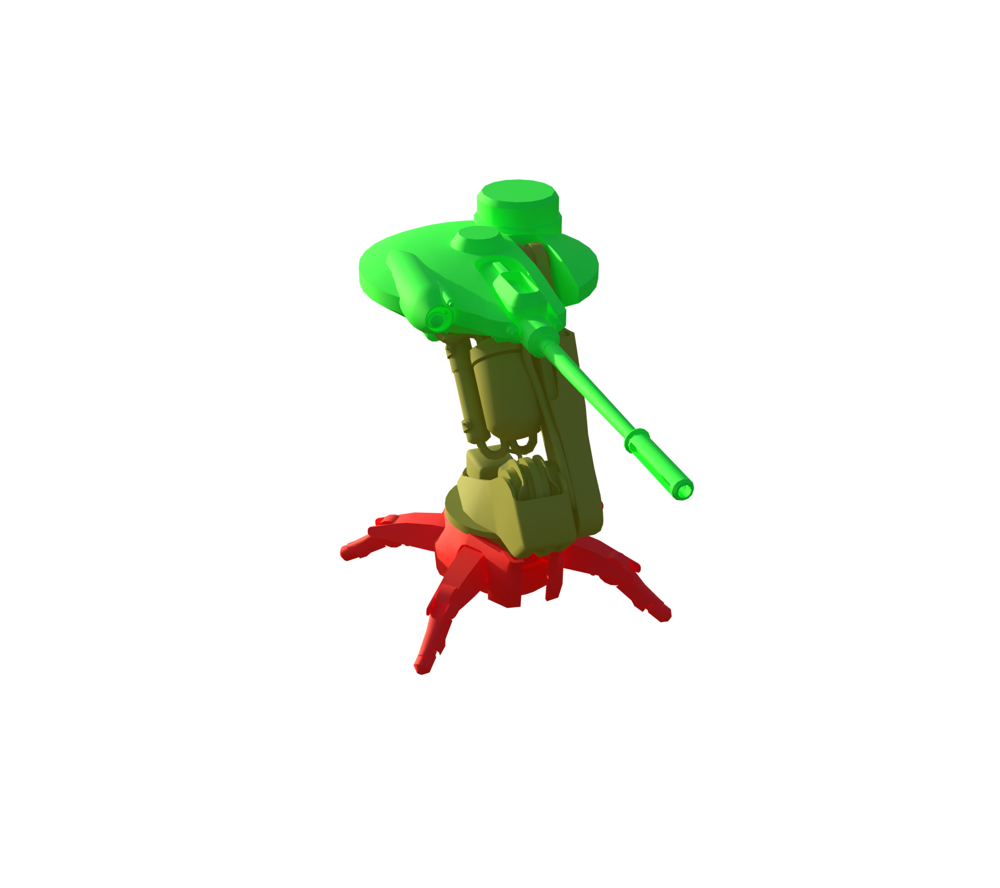
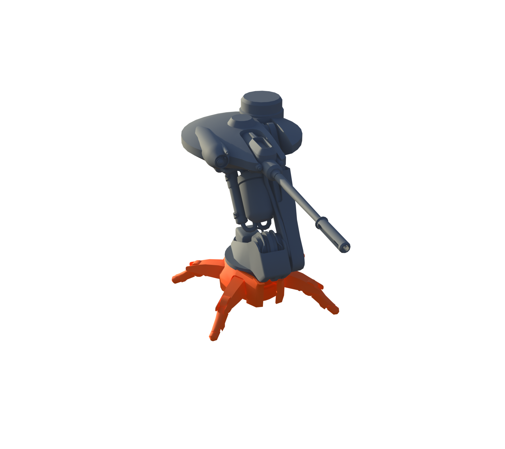
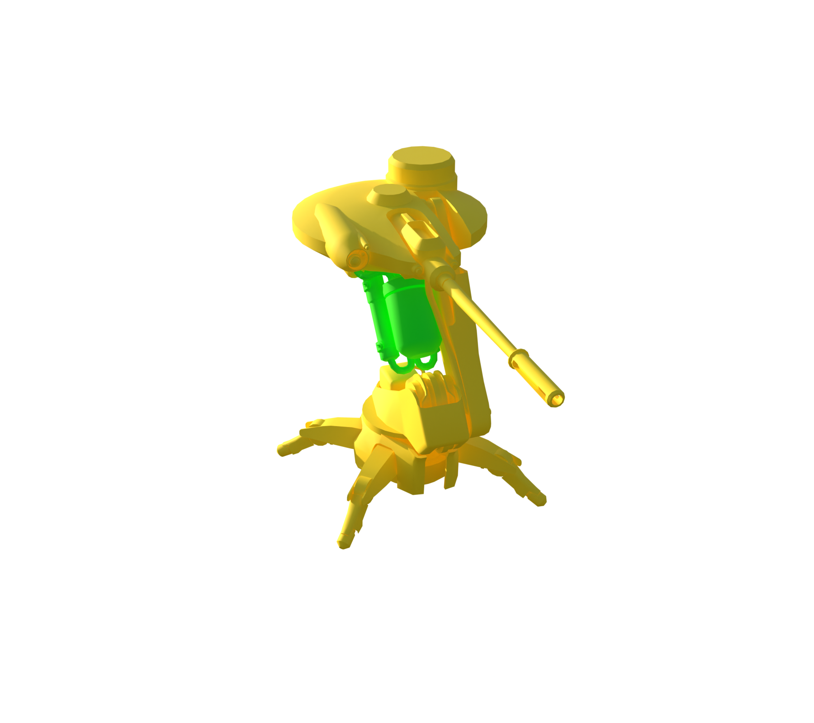

# Sentinel

[ARC stats](README.md) · [Machine-readable data](arc_parts.json) · [Damage model](Damage_Model.md)

**Configured frame rule:** 300 HP. **Internal class:** `C_Sniper`.

Frame HP is a balancing rule, not the sum of every limb or plate. Part rules and damage propagation are separate. `—` means unknown or unassigned.

[Interactive Blender inspection model](Models/Sentinel.blend) · Native textures and inspector are packed into the file.

### Layers and views

| Layer | Visible structure |
| --- | --- |
| A | Full model |

All six views, including inner layers

**A: Full model**

### Weak and critical parts

| Part | Configured HP | Group | Baseline physical damage × |
| --- | --- | --- | --- |
| Weakpoint | 225 | WeakPoint | 1.5 |

### Every named part

These records also include sockets, bones, and proxy components; they are not all independent damageable hitboxes. The weapon’s separate ARC armor and weak-point multipliers still apply where indicated in JSON.

| Part | Configured HP | Resistance group | Physical damage × | Health rules |
| --- | --- | --- | --- | --- |
| Muzzle | — | — | — |  |
| Laser | — | — | — |  |
| Body | 300 | Normal | 1 | 1 |
| ArmPivot | 300 | Normal | 1 | 1 |
| Arm | 300 | Normal | 1 | 1 |
| HeadOrienter | 300 | Normal | 1 | 1 |
| Head | 300 | Normal | 1 | 1 |
| Barrel | 300 | Normal | 1 | 0 |
| Weakpoint | 225 | WeakPoint | 1.5 | 2 |

### Exact health assignment rules

| Rule | Tag query | HP | Matched parts |
| --- | --- | --- | --- |
| 0 | ID.Weapon | 300 | Barrel |
| 1 | ANY(ID.Frame, ID.Head, ID.Arm, Group.Indestructible) | 300 | Body, ArmPivot, Arm, HeadOrienter, Head |
| 2 | Group.Weakpoint | 225 | Weakpoint |

Actual game source files

- [Content/Pioneer/Enemies/Sniper/CSSC_Sniper.json](../Sources/PioneerGame/Content/Pioneer/Enemies/Sniper/CSSC_Sniper.json)
- [Content/Pioneer/Enemies/Sniper/C_Sniper.json](../Sources/PioneerGame/Content/Pioneer/Enemies/Sniper/C_Sniper.json)
- [Content/Pioneer/Enemies/Sniper/DataAssets/DA_Balancing_C_Sniper.json](../Sources/PioneerGame/Content/Pioneer/Enemies/Sniper/DataAssets/DA_Balancing_C_Sniper.json)
- [Content/Pioneer/Enemies/Sniper/DataAssets/DA_EnemyMetaData_Sniper.json](../Sources/PioneerGame/Content/Pioneer/Enemies/Sniper/DataAssets/DA_EnemyMetaData_Sniper.json)
- [Content/Pioneer/Enemies/Sniper/DataAssets/DA_EnemyType_Sniper.json](../Sources/PioneerGame/Content/Pioneer/Enemies/Sniper/DataAssets/DA_EnemyType_Sniper.json)

