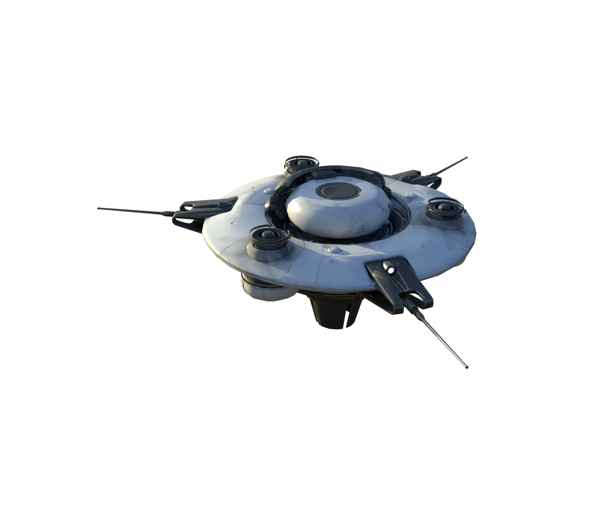
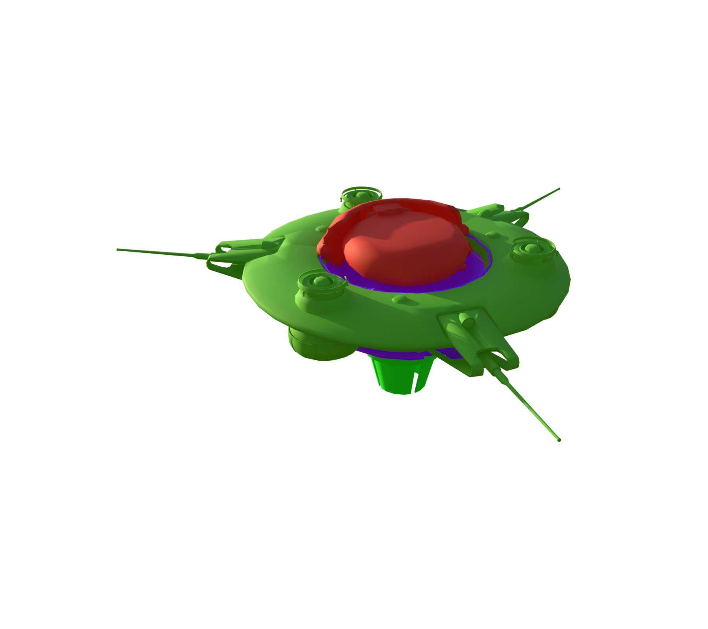
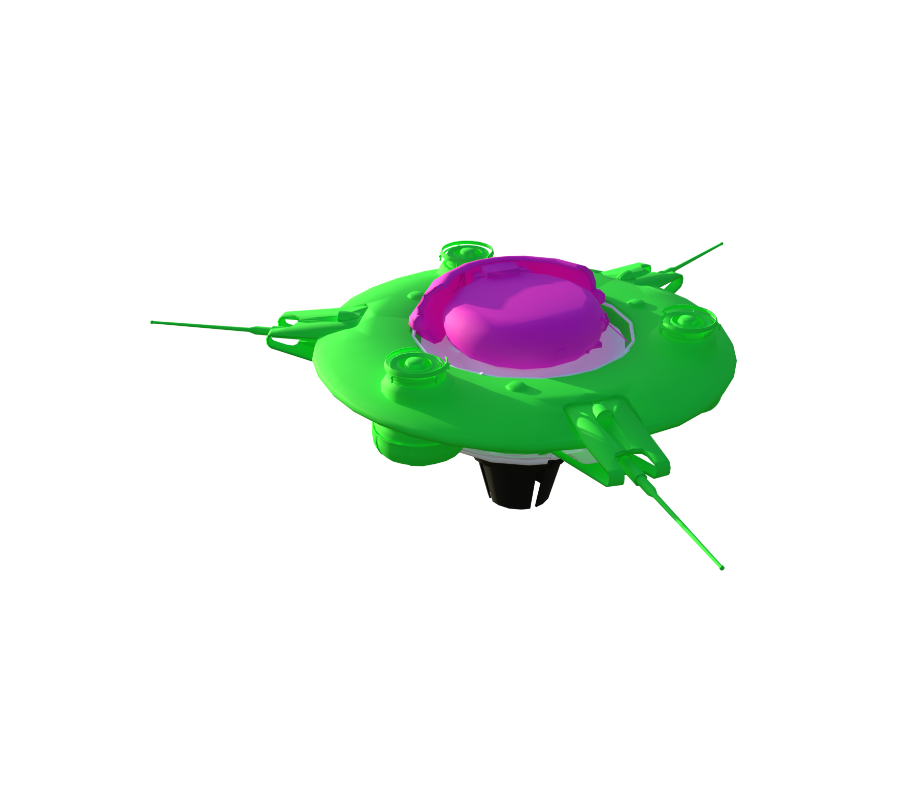
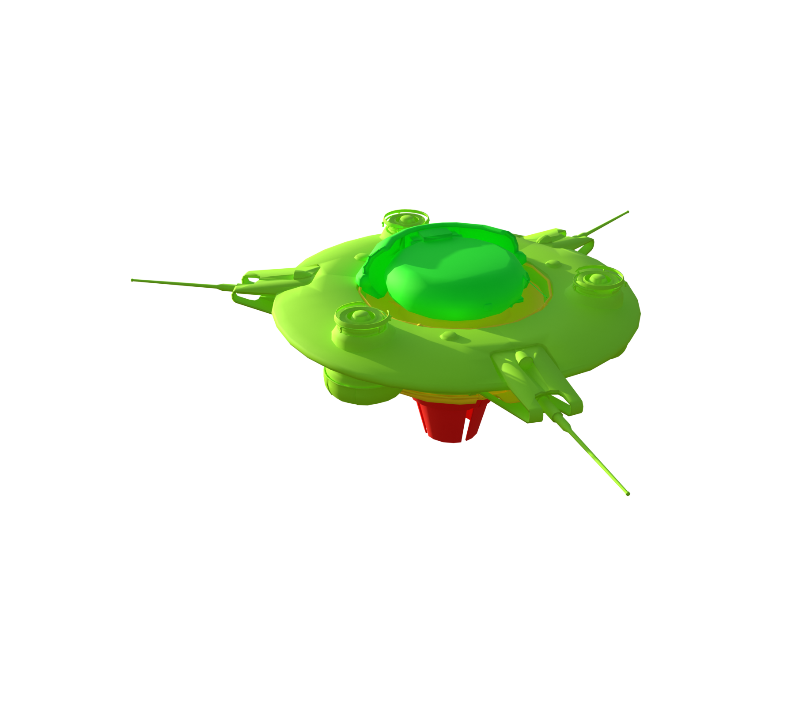

# Snitch

[ARC stats](README.md) · [Damage model](Damage_Model.md)

**Configured frame rule:** 158 HP. **Internal class:** `C_SnitchBot_01`.

Frame HP is assigned separately from part HP. A dash marks an unknown or unassigned value.

[Balancing and part HP](../Sources/PioneerGame/Content/Pioneer/Enemies/SnitchBot/Snitch_02/DataAssets/DA_Balancing_C_SnitchBot_01.json) · [Enemy type](../Sources/PioneerGame/Content/Pioneer/Enemies/SnitchBot/Snitch_02/DataAssets/DA_EnemyType_SnitchDrone.json)

More game files

- [C_SnitchBot_01.json](../Sources/PioneerGame/Content/Pioneer/Enemies/SnitchBot/Snitch_02/C_SnitchBot_01.json)
- [DA_EnemyMetaData_SnitchBot.json](../Sources/PioneerGame/Content/Pioneer/Enemies/SnitchBot/Snitch_02/DataAssets/DA_EnemyMetaData_SnitchBot.json)
- [CSSC_SnitchBot.json](../Sources/PioneerGame/Content/Pioneer/Enemies/SnitchBot/Snitch_02/SnitchBot_Skeleton/CSSC_SnitchBot.json)

[Interactive Blender inspection model](Models/Snitch.blend) · Native textures and inspector are packed into the file.

All stat renders

**Original materials**

  

**Part type**

  

**Part health**

  

**Break-off parts**

  

**Scavenging**

  

**Damage targets**

  

### Weak and critical parts

| Part | Configured HP | Group | Baseline physical damage × |
| --- | --- | --- | --- |
| Head_01 | 130 | Critical | 1.5 |

### Every named part

This list includes mesh records such as sockets and proxies. See the [damage model](Damage_Model.md) for how weapon multipliers apply to each resistance group.

| Part | Configured HP | Resistance group | Physical damage × | Health rules |
| --- | --- | --- | --- | --- |
| Frame_01 | 158 | Normal | 1 | 0 |
| Head_01 | 130 | Critical | 1.5 | 2 |
| LargeFlap_L_01 | 5 | Armor | 0.4 | 3 |
| LargeFlap_L_02 | 5 | Armor | 0.4 | 3 |
| LargeFlap_R_01 | 5 | Armor | 0.4 | 3 |
| LargeFlap_R_02 | 5 | Armor | 0.4 | 3 |
| SubFrame_01 | 48 | Fragile | 1.2 | 4 |
| SubFrame_02 | 48 | Fragile | 1.2 | 4 |
| SubFrame_03 | 48 | Fragile | 1.2 | 4 |
| ScannerRoot | 150 | Normal | 1 | 1 |
| Frame_Thruster_L | — | Fragile | 1.2 |  |
| Frame_Thruster_Re | — | Fragile | 1.2 |  |
| Frame_Thruster_R | — | Fragile | 1.2 |  |
| Thruster_03 | — | Fragile | 1.2 |  |
| Thruster_02 | — | Fragile | 1.2 |  |
| Thruster_01 | — | Fragile | 1.2 |  |

### Exact health assignment rules

| Rule | Tag query | HP | Matched parts |
| --- | --- | --- | --- |
| 0 | ID.Frame | 158 | Frame_01 |
| 1 | ID.Radar | 150 | ScannerRoot |
| 2 | ID.Head | 130 | Head_01 |
| 3 | ID.Armor.Light | 5 | LargeFlap_L_01, LargeFlap_L_02, LargeFlap_R_01, LargeFlap_R_02 |
| 4 | HealthGroup.SubParts | 48 | SubFrame_01, SubFrame_02, SubFrame_03 |

Destruction and stun rules

**Chain destruction**

| Trigger part | Configured threshold | Parts destroyed |
| --- | --- | --- |
| SubFrame_02 | 1% HP | SubFrame_02, Frame_Thruster_R, Thruster_02 |
| SubFrame_01 | 1% HP | SubFrame_01, Frame_Thruster_L, Thruster_01 |
| SubFrame_03 | 1% HP | SubFrame_03, Frame_Thruster_Re, Thruster_03 |

