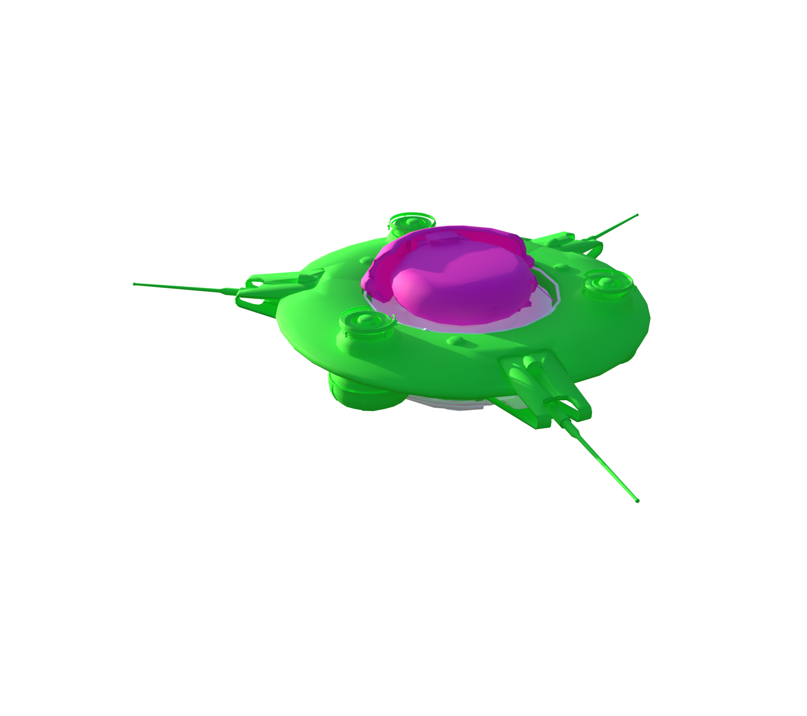
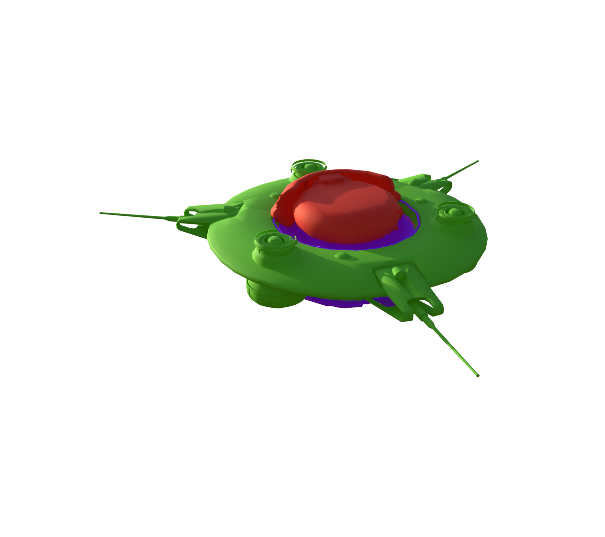
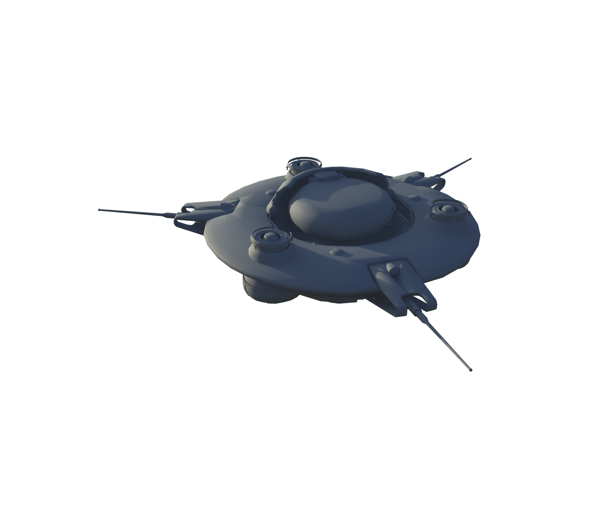
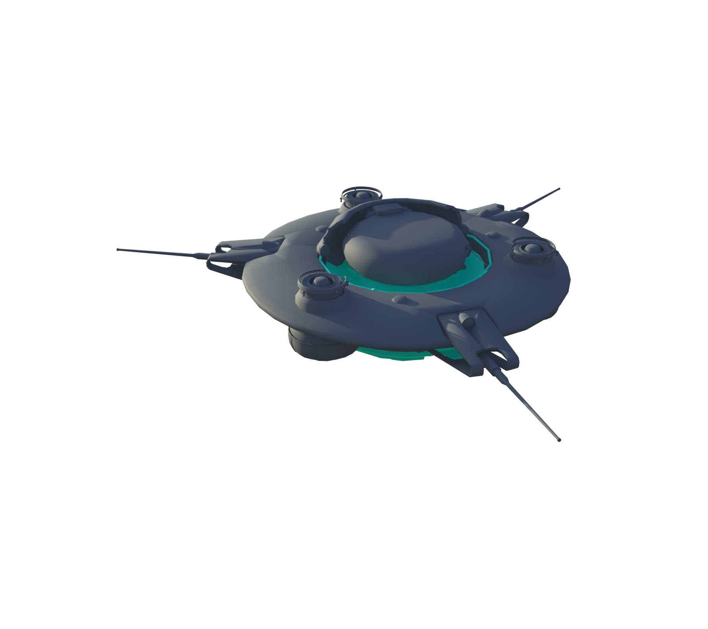

# Snitch

[ARC stats](README.md) · [Machine-readable data](arc_parts.json) · [Damage model](Damage_Model.md)

**Configured frame rule:** 158 HP. **Internal class:** `C_SnitchBot_01`.

Frame HP is a balancing rule, not the sum of every limb or plate. Part rules and damage propagation are separate. `—` means unknown or unassigned.

[Interactive Blender inspection model](Models/Snitch.blend) · Native textures and inspector are packed into the file.

### Layers and views

| Layer | Visible structure |
| --- | --- |
| A | Without armor |
| B | Full model |

All six views, including inner layers

**A: Without armor**

**B: Full model**

### Weak and critical parts

| Part | Configured HP | Group | Baseline physical damage × |
| --- | --- | --- | --- |
| Head_01 | 130 | Critical | 1.5 |

### Every named part

These records also include sockets, bones, and proxy components; they are not all independent damageable hitboxes. The weapon’s separate ARC armor and weak-point multipliers still apply where indicated in JSON.

| Part | Configured HP | Resistance group | Physical damage × | Health rules |
| --- | --- | --- | --- | --- |
| Frame_01 | 158 | Normal | 1 | 0 |
| Head_01 | 130 | Critical | 1.5 | 2 |
| LargeFlap_L_01 | 5 | Armor | 0.4 | 3 |
| LargeFlap_L_02 | 5 | Armor | 0.4 | 3 |
| LargeFlap_R_01 | 5 | Armor | 0.4 | 3 |
| LargeFlap_R_02 | 5 | Armor | 0.4 | 3 |
| SubFrame_01 | 48 | Fragile | 1.2 | 4 |
| SubFrame_02 | 48 | Fragile | 1.2 | 4 |
| SubFrame_03 | 48 | Fragile | 1.2 | 4 |
| ScannerRoot | 150 | Normal | 1 | 1 |
| Frame_Thruster_L | — | Fragile | 1.2 |  |
| Frame_Thruster_Re | — | Fragile | 1.2 |  |
| Frame_Thruster_R | — | Fragile | 1.2 |  |
| Thruster_03 | — | Fragile | 1.2 |  |
| Thruster_02 | — | Fragile | 1.2 |  |
| Thruster_01 | — | Fragile | 1.2 |  |

### Exact health assignment rules

| Rule | Tag query | HP | Matched parts |
| --- | --- | --- | --- |
| 0 | ID.Frame | 158 | Frame_01 |
| 1 | ID.Radar | 150 | ScannerRoot |
| 2 | ID.Head | 130 | Head_01 |
| 3 | ID.Armor.Light | 5 | LargeFlap_L_01, LargeFlap_L_02, LargeFlap_R_01, LargeFlap_R_02 |
| 4 | HealthGroup.SubParts | 48 | SubFrame_01, SubFrame_02, SubFrame_03 |

Some actor/style sources have partial-decoding warnings; the balancing health tables parsed separately. The JSON retains the warnings and recovered destruction settings.

Actual game source files

- [Content/Pioneer/Enemies/SnitchBot/Snitch_02/C_SnitchBot_01.json](../Sources/PioneerGame/Content/Pioneer/Enemies/SnitchBot/Snitch_02/C_SnitchBot_01.json)
- [Content/Pioneer/Enemies/SnitchBot/Snitch_02/DataAssets/DA_Balancing_C_SnitchBot_01.json](../Sources/PioneerGame/Content/Pioneer/Enemies/SnitchBot/Snitch_02/DataAssets/DA_Balancing_C_SnitchBot_01.json)
- [Content/Pioneer/Enemies/SnitchBot/Snitch_02/DataAssets/DA_EnemyMetaData_SnitchBot.json](../Sources/PioneerGame/Content/Pioneer/Enemies/SnitchBot/Snitch_02/DataAssets/DA_EnemyMetaData_SnitchBot.json)
- [Content/Pioneer/Enemies/SnitchBot/Snitch_02/DataAssets/DA_EnemyType_SnitchDrone.json](../Sources/PioneerGame/Content/Pioneer/Enemies/SnitchBot/Snitch_02/DataAssets/DA_EnemyType_SnitchDrone.json)
- [Content/Pioneer/Enemies/SnitchBot/Snitch_02/SnitchBot_Skeleton/CSSC_SnitchBot.json](../Sources/PioneerGame/Content/Pioneer/Enemies/SnitchBot/Snitch_02/SnitchBot_Skeleton/CSSC_SnitchBot.json)

