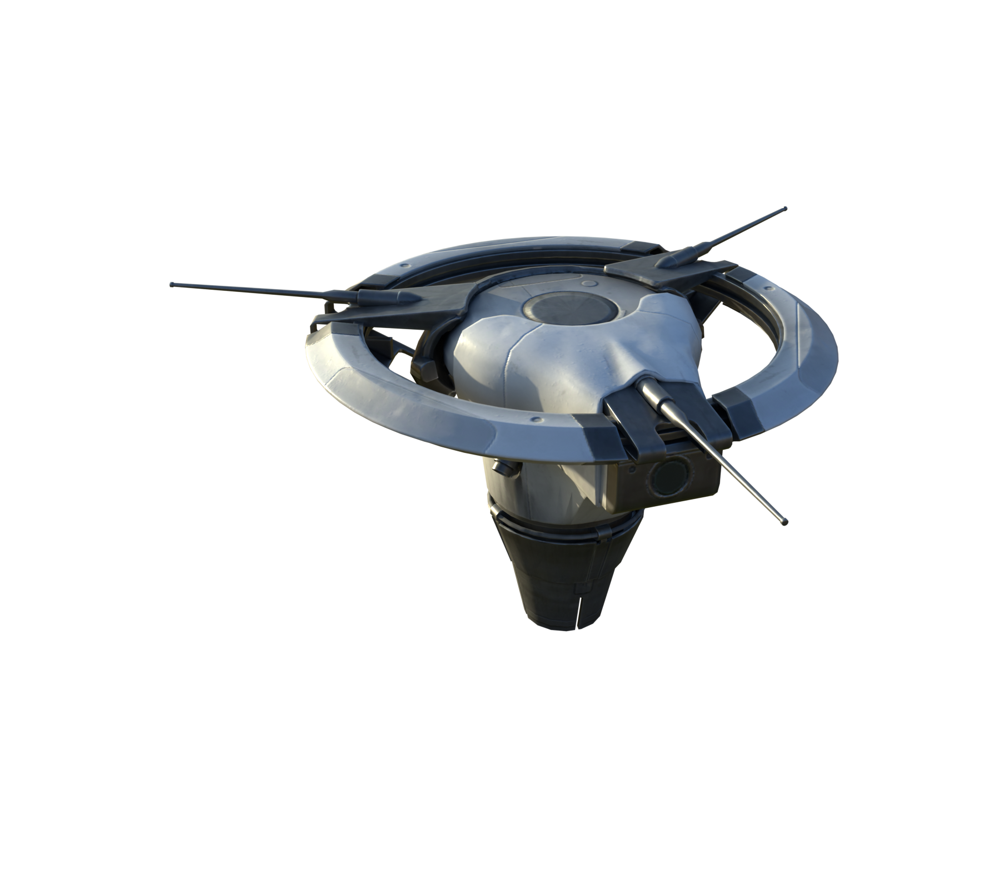
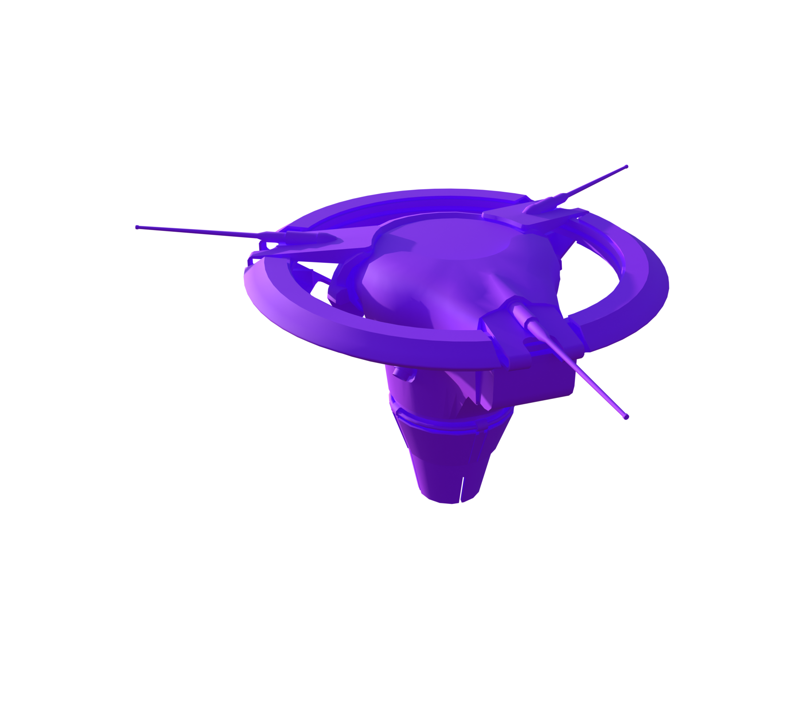
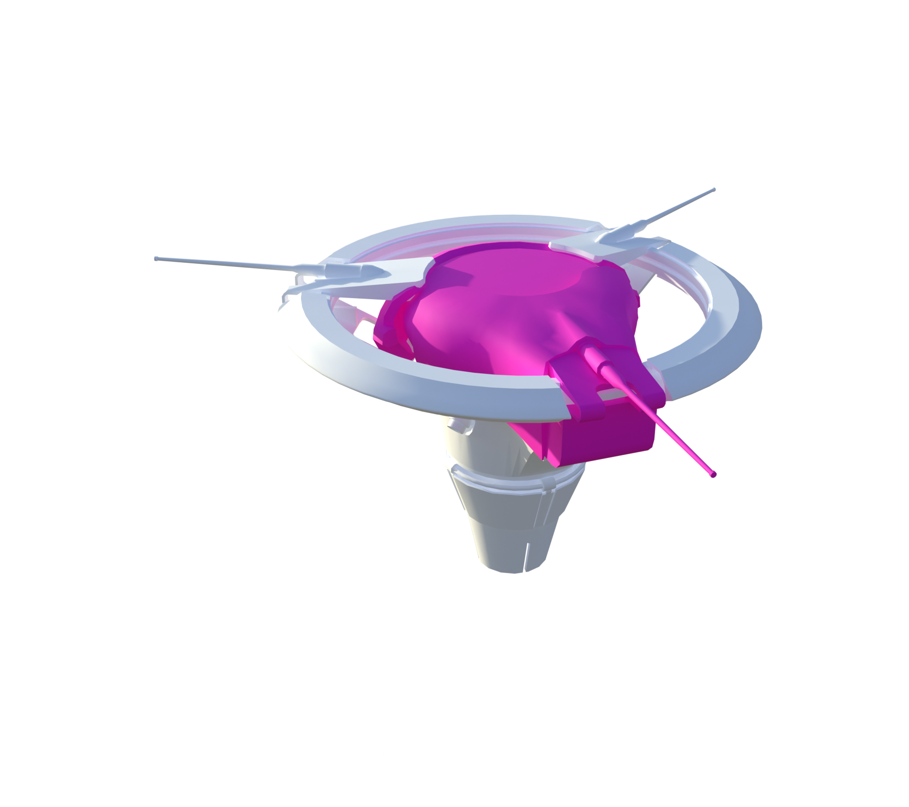
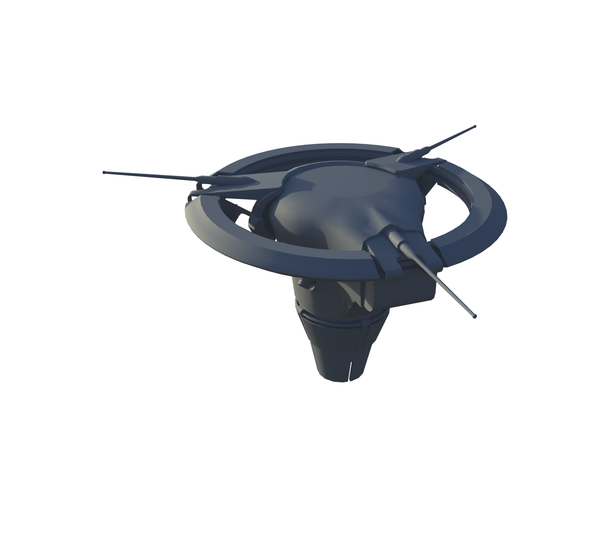
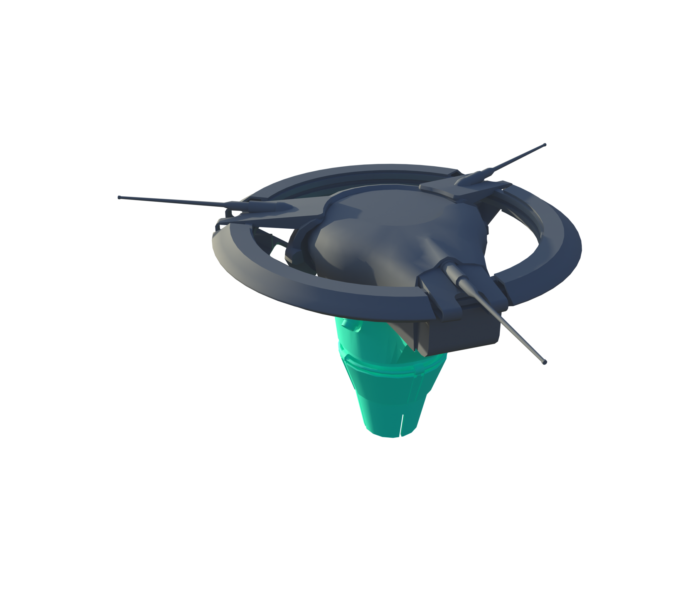
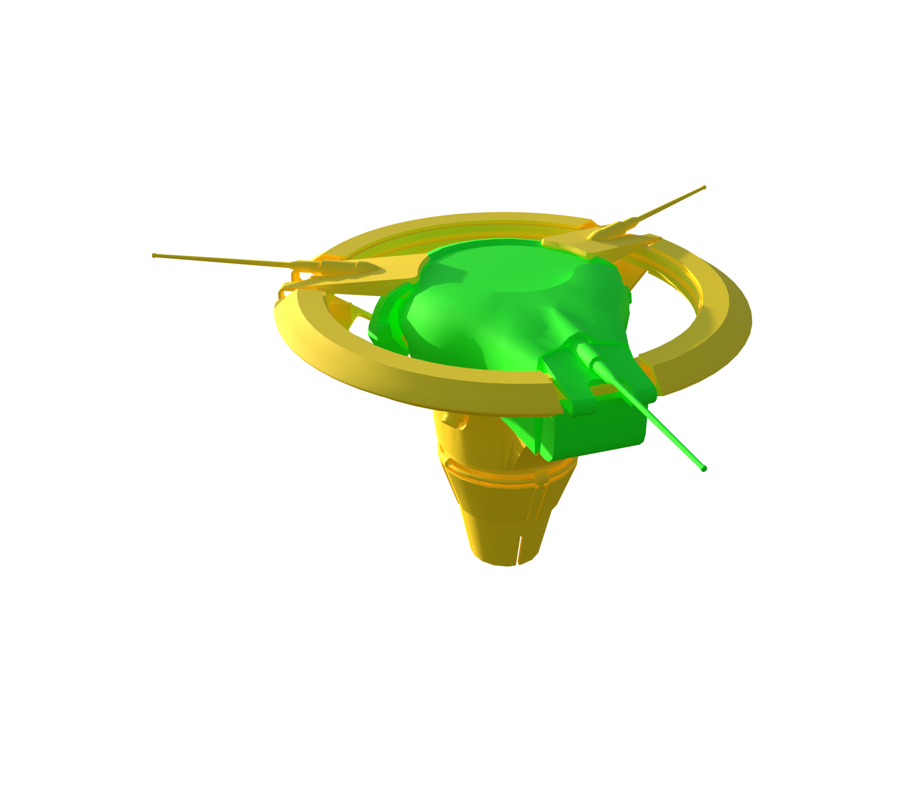

# Spotter

[ARC stats](README.md) · [Damage model](Damage_Model.md)

**Configured frame rule:** 80 HP. **Internal class:** `C_Pinger`.

Frame HP is assigned separately from part HP. A dash marks an unknown or unassigned value.

[Balancing and part HP](../Sources/PioneerGame/Content/Pioneer/Enemies/Pinger/DataAssets/DA_Balancing_C_Pinger.json) · [Enemy type](../Sources/PioneerGame/Content/Pioneer/Enemies/Pinger/DataAssets/DA_EnemyType_Pinger.json)

More game files

- [C_Pinger.json](../Sources/PioneerGame/Content/Pioneer/Enemies/Pinger/C_Pinger.json)
- [CSSC_Pinger.json](../Sources/PioneerGame/Content/Pioneer/Enemies/Pinger/DataAssets/CSSC_Pinger.json)
- [DA_EnemyMetaData_Pinger.json](../Sources/PioneerGame/Content/Pioneer/Enemies/Pinger/DataAssets/DA_EnemyMetaData_Pinger.json)

[Interactive Blender inspection model](Models/Spotter.blend) · Native textures and inspector are packed into the file.

All stat renders

**Original materials**

  

**Part type**

  

**Part health**

  

**Break-off parts**

  

**Scavenging**

  

**Damage targets**

  

### Weak and critical parts

| Part | Configured HP | Group | Baseline physical damage × |
| --- | --- | --- | --- |
| Head_01 | 120 | Critical | 1.5 |

### Every named part

This list includes mesh records such as sockets and proxies. See the [damage model](Damage_Model.md) for how weapon multipliers apply to each resistance group.

| Part | Configured HP | Resistance group | Physical damage × | Health rules |
| --- | --- | --- | --- | --- |
| Laser | — | — | — |  |
| Frame_01 | 80 | Normal | 1 | 0 |
| Head_01 | 120 | Critical | 1.5 | 2 |
| Ring_C_01 | 120 | Normal | 1 | 3 |
| ScannerRoot | 180 | Normal | 1 | 1 |
| Thruster_L_01 | — | Fragile | 1.2 |  |
| Thruster_L_02 | — | Fragile | 1.2 |  |
| Thruster_R_01 | — | Fragile | 1.2 |  |
| Thruster_R_02 | — | Fragile | 1.2 |  |
| Thruster_Virtual_L_01 | — | Fragile | 1.2 |  |
| Thruster_Virtual_L_02 | — | Fragile | 1.2 |  |
| Thruster_Virtual_R_01 | — | Fragile | 1.2 |  |
| Thruster_Virtual_R_02 | — | Fragile | 1.2 |  |

### Exact health assignment rules

| Rule | Tag query | HP | Matched parts |
| --- | --- | --- | --- |
| 0 | ID.Frame | 80 | Frame_01 |
| 1 | ID.Radar | 180 | ScannerRoot |
| 2 | ID.Head | 120 | Head_01 |
| 3 | ANY(HealthGroup.Base) | 120 | Ring_C_01 |
