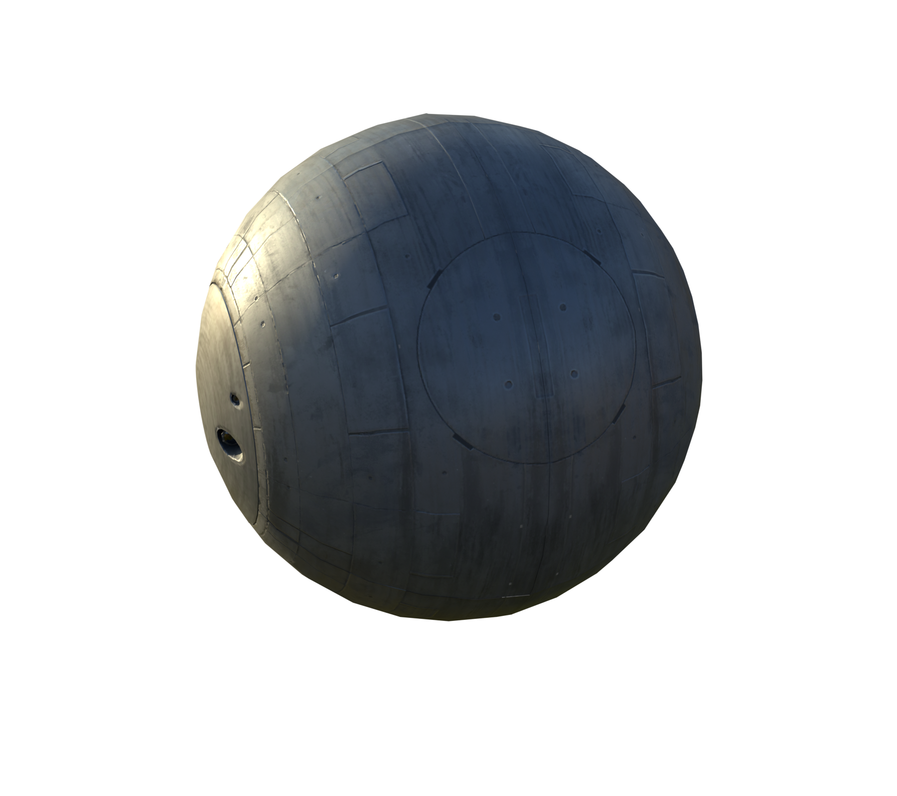
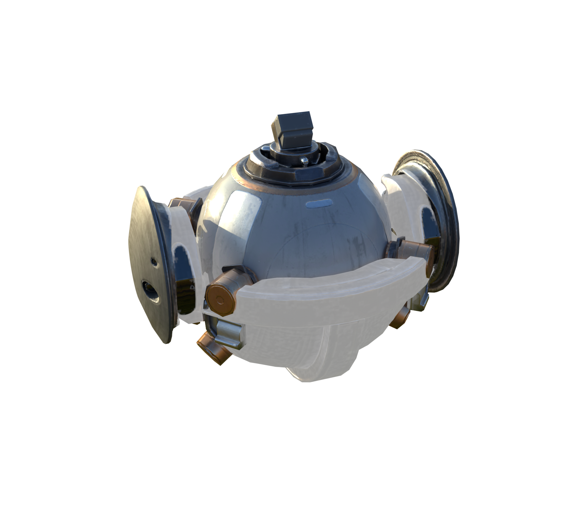
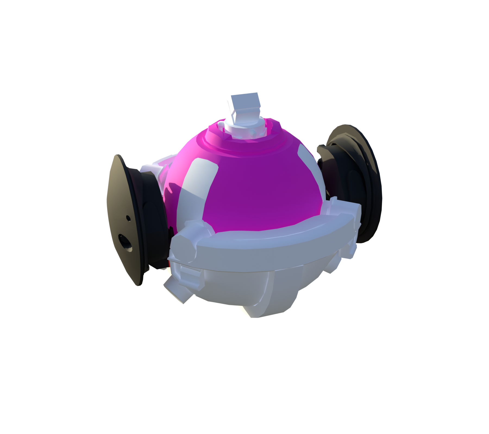
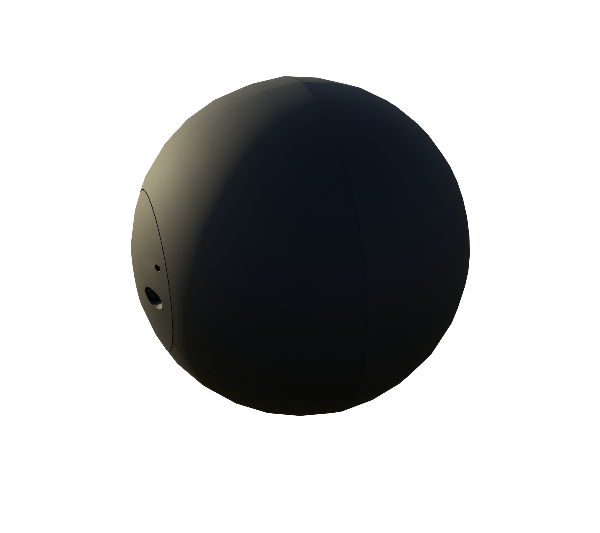
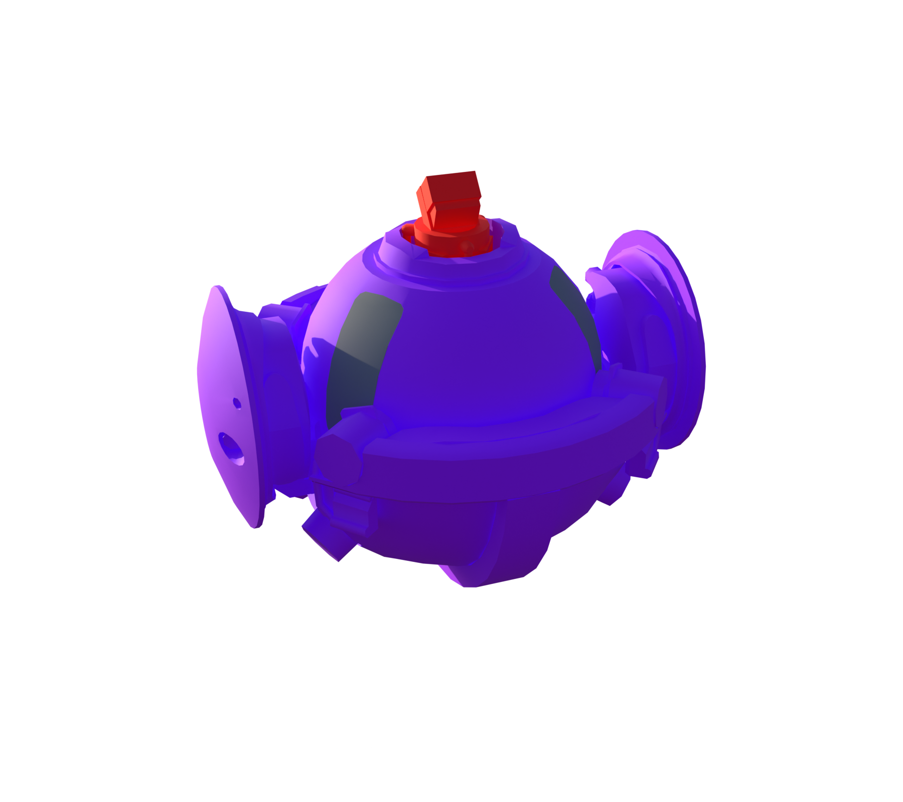
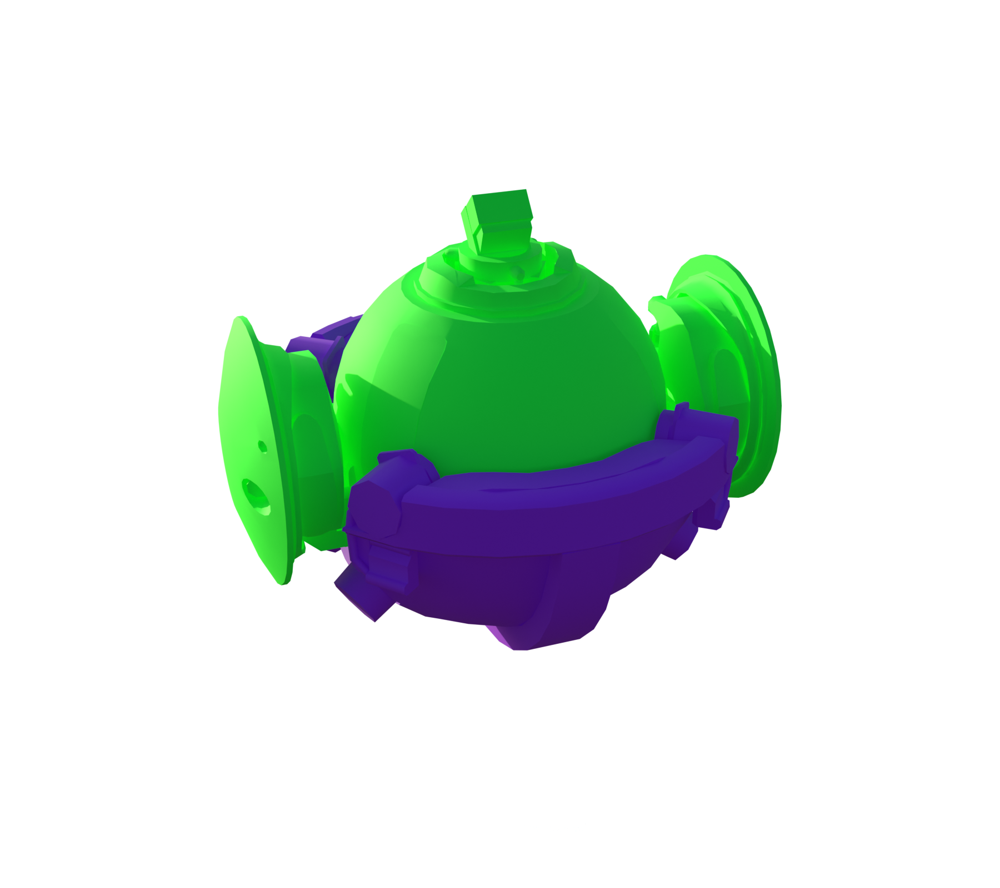
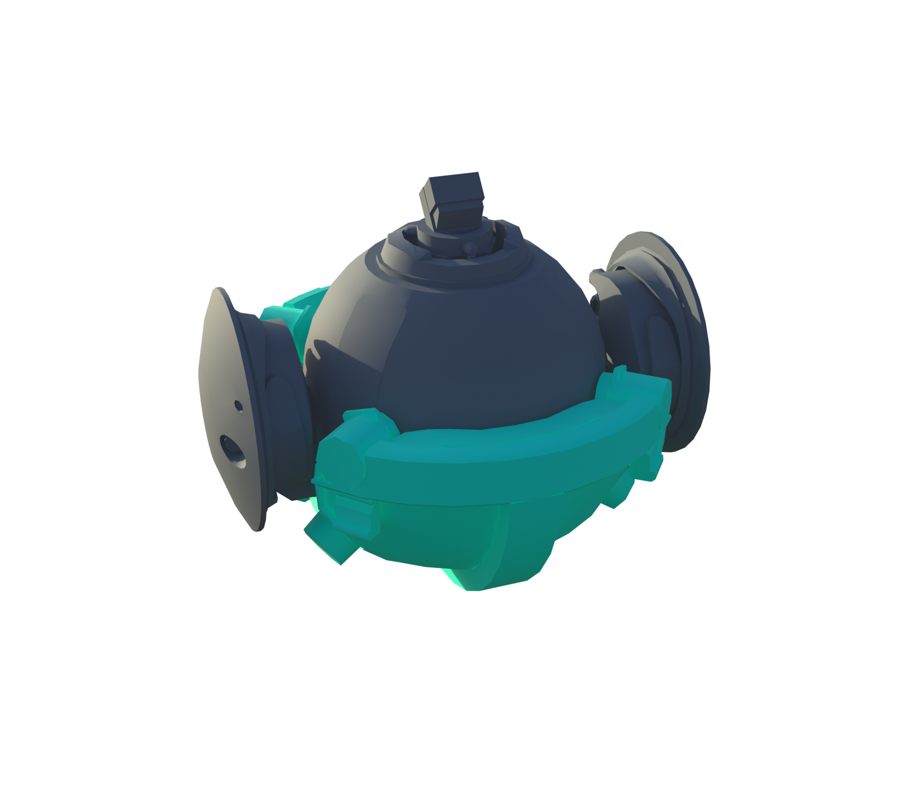
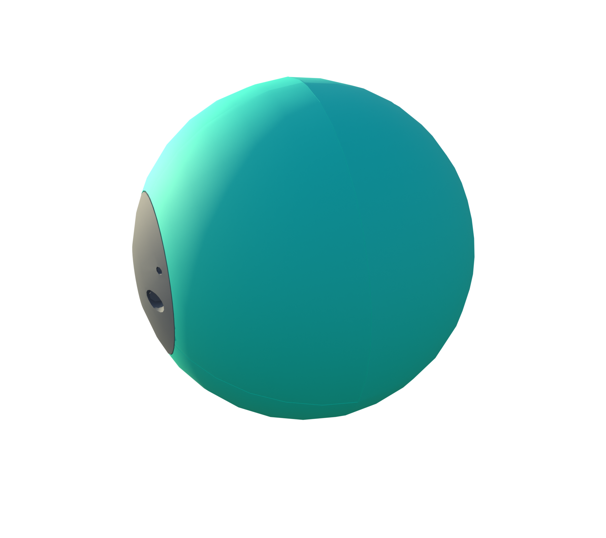
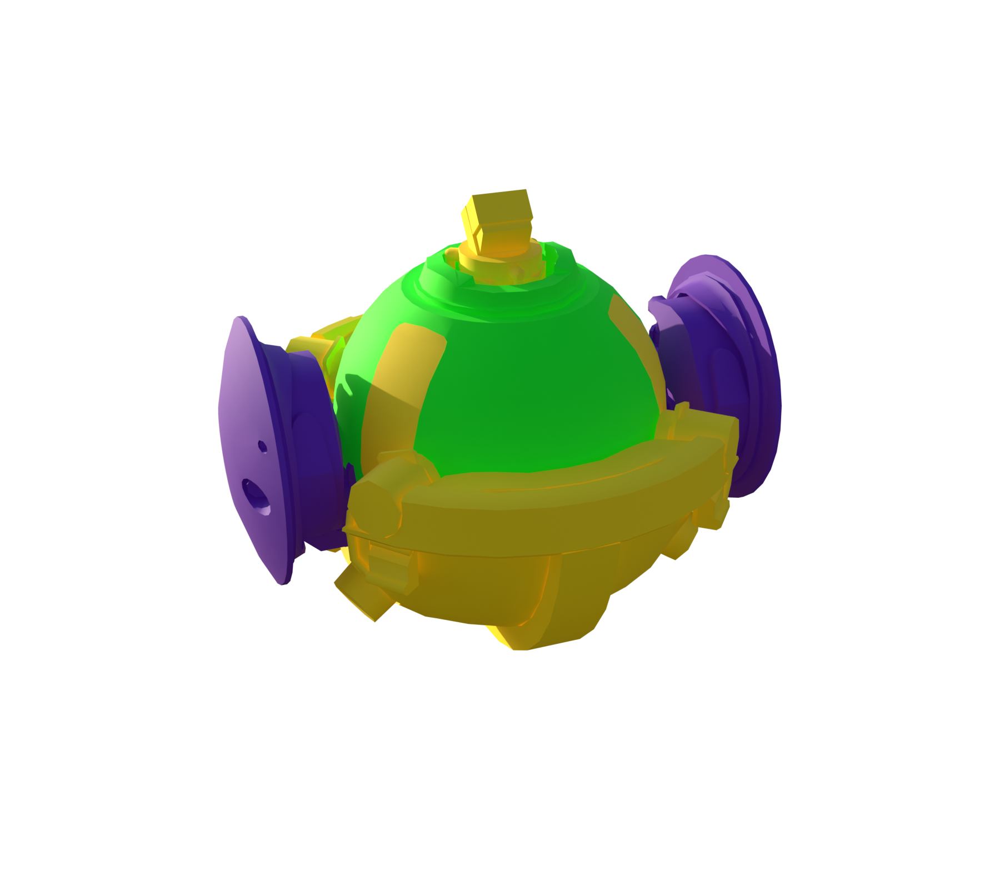
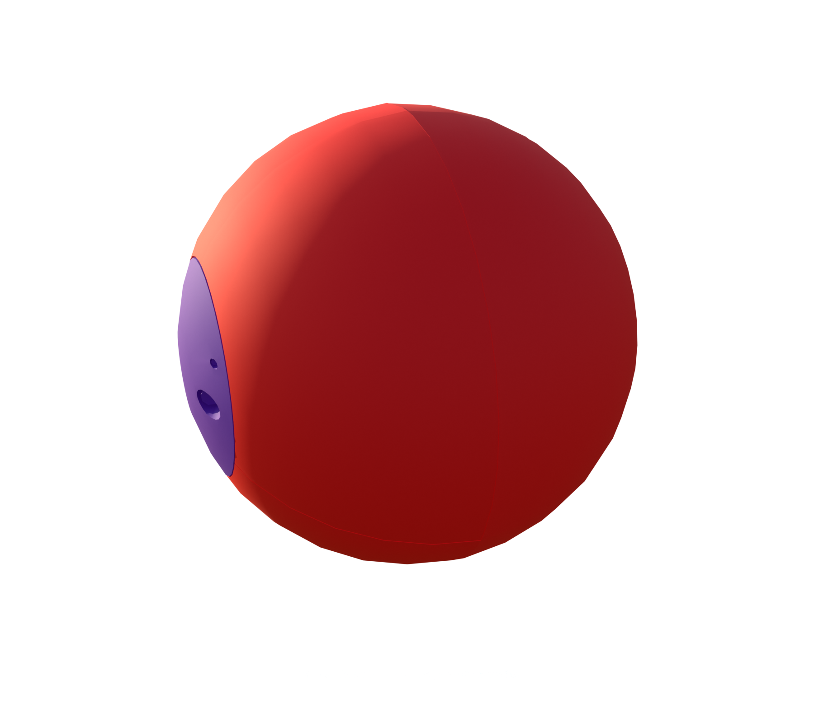

# ARC Surveyor

[ARC stats](README.md) · [Machine-readable data](arc_parts.json) · [Damage model](Damage_Model.md)

**Configured frame rule:** 257 HP. **Internal class:** `C_RollBot_01_Blockout_Normal`.

Frame HP is a balancing rule, not the sum of every limb or plate. Part rules and damage propagation are separate. `—` means unknown or unassigned.

[Interactive Blender inspection model](Models/Surveyor.blend) · Native textures and inspector are packed into the file.

All stat renders

**Original materials**

  
  

**Part type**

  
  

**Part health**

  
  

**Break-off parts**

  
  

**Scavenging**

  
  

**Damage targets**

  
  

### Weak and critical parts

| Part | Configured HP | Group | Baseline physical damage × |
| --- | --- | --- | --- |
| Core | 1300 | Critical | 1.5 |

### Every named part

These records also include sockets, bones, and proxy components; they are not all independent damageable hitboxes. The weapon’s separate ARC armor and weak-point multipliers still apply where indicated in JSON.

| Part | Configured HP | Resistance group | Physical damage × | Health rules |
| --- | --- | --- | --- | --- |
| DummyParent_Root | 1000 | Normal | 1 | 5 |
| Armor_01_L_01 | 14 | Armor | 0.4 | 1 |
| Armor_01_L_02 | 14 | Armor | 0.4 | 1 |
| Armor_01_L_03 | 14 | Armor | 0.4 | 1 |
| Armor_01_R_01 | 14 | Armor | 0.4 | 1 |
| Armor_01_R_02 | 14 | Armor | 0.4 | 1 |
| Armor_01_R_03 | 14 | Armor | 0.4 | 1 |
| Armor_02_L_01 | 37 | Armor | 0.4 | 0 |
| Armor_02_L_02 | 37 | Armor | 0.4 | 0 |
| Armor_02_L_03 | 37 | Armor | 0.4 | 0 |
| Armor_02_R_01 | 37 | Armor | 0.4 | 0 |
| Armor_02_R_02 | 37 | Armor | 0.4 | 0 |
| Armor_02_R_03 | 37 | Armor | 0.4 | 0 |
| Frame | 257 | Normal | 1 | 4 |
| CenterAxis | — | Normal | 1 |  |
| RifleHinge_L_01 | 1000 | Sturdy | 0.4 | 2 |
| RifleBody_L | 1000 | Armor | 0.4 | 2 |
| LaserSource_L | — | Normal | 1 |  |
| Muzzle_Lower_L | — | Normal | 1 |  |
| Muzzle_Upper_L | — | Normal | 1 |  |
| RifleHinge_R_01 | 1000 | Sturdy | 0.4 | 2 |
| RifleBody_R | 1000 | Armor | 0.4 | 2 |
| LaserSource_R | — | Normal | 1 |  |
| Muzzle_Lower_R | — | Normal | 1 |  |
| Muzzle_Upper_R | — | Normal | 1 |  |
| PerceptionPart | — | Normal | 1 |  |
| Core | 1300 | Critical | 1.5 | 3 |
| Antenna_A | 100 | Normal | 1 | 6 |
| Antenna_B | 100 | Normal | 1 | 6 |
| Lid_01 | — | Normal | 1 |  |
| Arm_A_01 | — | Normal | 1 |  |
| Arm_B_01 | — | Normal | 1 |  |
| Lid_02 | — | Normal | 1 |  |
| Arm_A_02 | — | Normal | 1 |  |
| Arm_B_02 | — | Normal | 1 |  |
| Lid_03 | — | Normal | 1 |  |
| Arm_A_03 | — | Normal | 1 |  |
| Arm_B_03 | — | Normal | 1 |  |

### Exact health assignment rules

| Rule | Tag query | HP | Matched parts |
| --- | --- | --- | --- |
| 0 | ID.Armor.Heavy | 37 | Armor_02_L_01, Armor_02_L_02, Armor_02_L_03, Armor_02_R_01, Armor_02_R_02, Armor_02_R_03 |
| 1 | ID.Armor.Light | 14 | Armor_01_L_01, Armor_01_L_02, Armor_01_L_03, Armor_01_R_01, Armor_01_R_02, Armor_01_R_03 |
| 2 | Group.Indestructible | 1000 | RifleHinge_L_01, RifleBody_L, RifleHinge_R_01, RifleBody_R |
| 3 | ID.Core | 1300 | Core |
| 4 | ID.Frame | 257 | Frame |
| 5 | ID.Rollbot.Root | 1000 | DummyParent_Root |
| 6 | ANY(ID.Antenna) | 100 | Antenna_A, Antenna_B |

Actual game source files

- [Content/Pioneer/Enemies/RollBot/Rollbot_Normal_Version/C_RollBot_01_Blockout_Normal.json](../Sources/PioneerGame/Content/Pioneer/Enemies/RollBot/Rollbot_Normal_Version/C_RollBot_01_Blockout_Normal.json)
- [Content/Pioneer/Enemies/RollBot/Rollbot_Normal_Version/DataAssets/CSSC_Rollbot.json](../Sources/PioneerGame/Content/Pioneer/Enemies/RollBot/Rollbot_Normal_Version/DataAssets/CSSC_Rollbot.json)
- [Content/Pioneer/Enemies/RollBot/Rollbot_Normal_Version/DataAssets/DA_Balancing_C_RollBot_01_Blockout_Normal.json](../Sources/PioneerGame/Content/Pioneer/Enemies/RollBot/Rollbot_Normal_Version/DataAssets/DA_Balancing_C_RollBot_01_Blockout_Normal.json)
- [Content/Pioneer/Enemies/RollBot/Rollbot_Normal_Version/DataAssets/DA_EnemyMetaData_RollBot_Normal.json](../Sources/PioneerGame/Content/Pioneer/Enemies/RollBot/Rollbot_Normal_Version/DataAssets/DA_EnemyMetaData_RollBot_Normal.json)
- [Content/Pioneer/Enemies/RollBot/Rollbot_Normal_Version/DataAssets/DA_EnemyType_RollBot.json](../Sources/PioneerGame/Content/Pioneer/Enemies/RollBot/Rollbot_Normal_Version/DataAssets/DA_EnemyType_RollBot.json)

