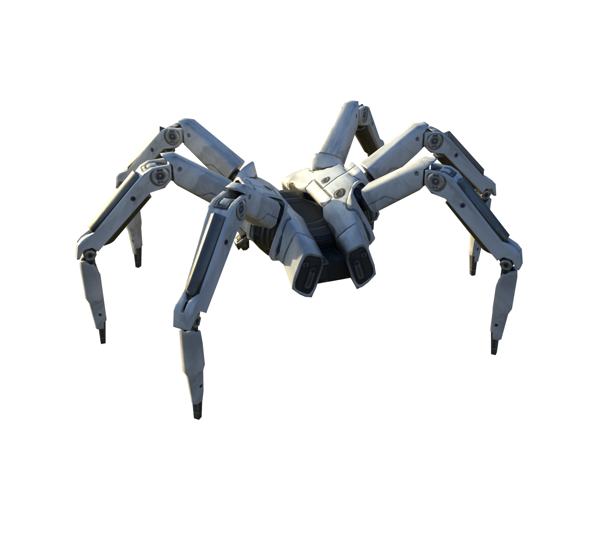
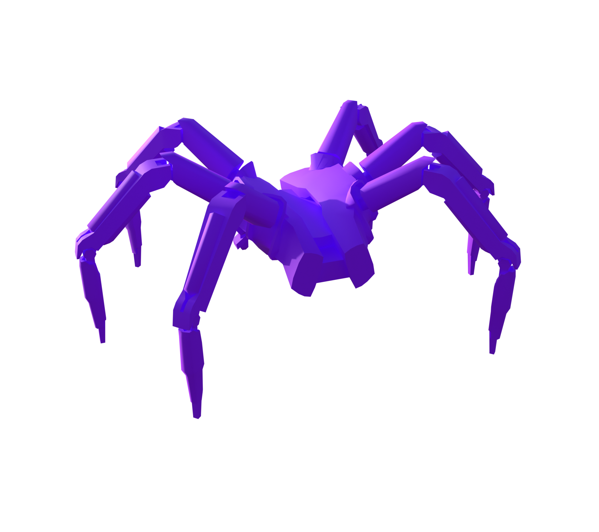
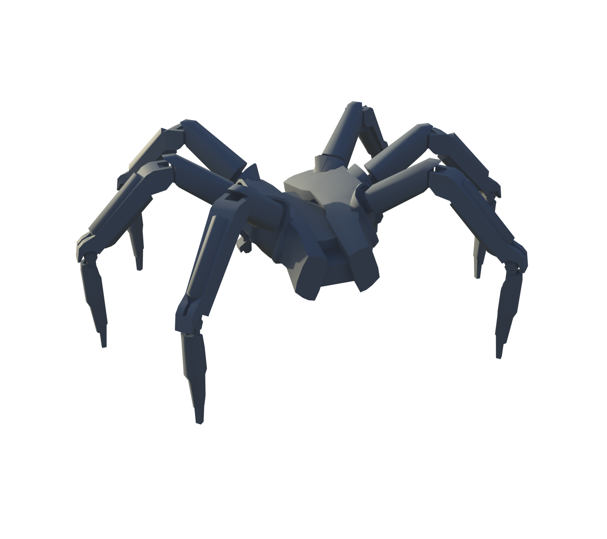
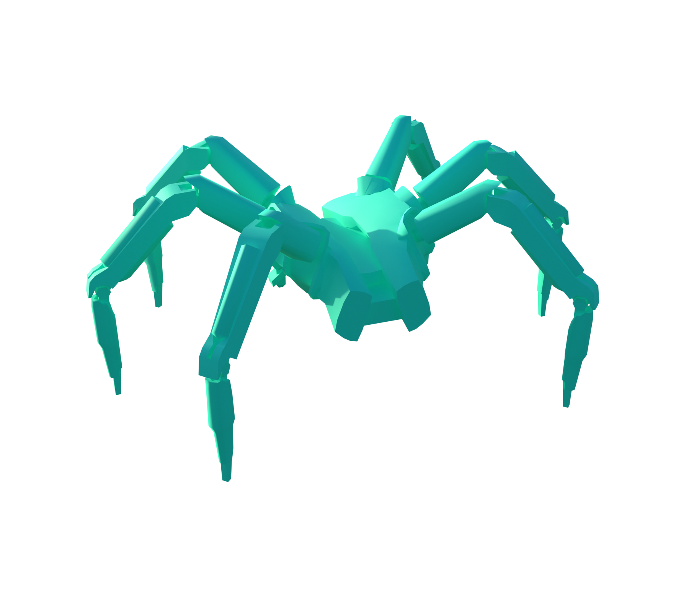

# Tick

[ARC stats](README.md) · [Machine-readable data](arc_parts.json) · [Damage model](Damage_Model.md)

**Configured frame rule:** 10 HP. **Internal class:** `C_TickBot`.

Frame HP is a balancing rule, not the sum of every limb or plate. Part rules and damage propagation are separate. `—` means unknown or unassigned.

[Interactive Blender inspection model](Models/Tick.blend) · Native textures and inspector are packed into the file.

### Layers and views

| Layer | Visible structure |
| --- | --- |
| A | Full model |

All six views, including inner layers

**A: Full model**

### Weak and critical parts

No explicit WeakPoint/Critical resistance assignment was recovered for this profile. This does not imply invulnerability.

### Every named part

These records also include sockets, bones, and proxy components; they are not all independent damageable hitboxes. The weapon’s separate ARC armor and weak-point multipliers still apply where indicated in JSON.

| Part | Configured HP | Resistance group | Physical damage × | Health rules |
| --- | --- | --- | --- | --- |
| Frame | 10 | — | — | 3 |

### Exact health assignment rules

| Rule | Tag query | HP | Matched parts |
| --- | --- | --- | --- |
| 0 | ID.Core | 10 |  |
| 1 | ID.Claw | 10 |  |
| 2 | ID.Leg | 10 |  |
| 3 | ID.Frame | 10 | Frame |
| 4 | ID.Armor.Light | 10 |  |
| 5 | Group.Indestructible | 10000 |  |

Actual game source files

- [Content/Pioneer/Enemies/Tick/C_TickBot.json](../Sources/PioneerGame/Content/Pioneer/Enemies/Tick/C_TickBot.json)
- [Content/Pioneer/Enemies/Tick/DA_Balancing_C_TickBot.json](../Sources/PioneerGame/Content/Pioneer/Enemies/Tick/DA_Balancing_C_TickBot.json)
- [Content/Pioneer/Enemies/Tick/DA_EnemyMetaData_TickBot.json](../Sources/PioneerGame/Content/Pioneer/Enemies/Tick/DA_EnemyMetaData_TickBot.json)
- [Content/Pioneer/Enemies/Tick/DA_EnemyType_Tick.json](../Sources/PioneerGame/Content/Pioneer/Enemies/Tick/DA_EnemyType_Tick.json)
- [Content/Pioneer/Enemies/Tick/TickBot/CS_TickBot_01.json](../Sources/PioneerGame/Content/Pioneer/Enemies/Tick/TickBot/CS_TickBot_01.json)

