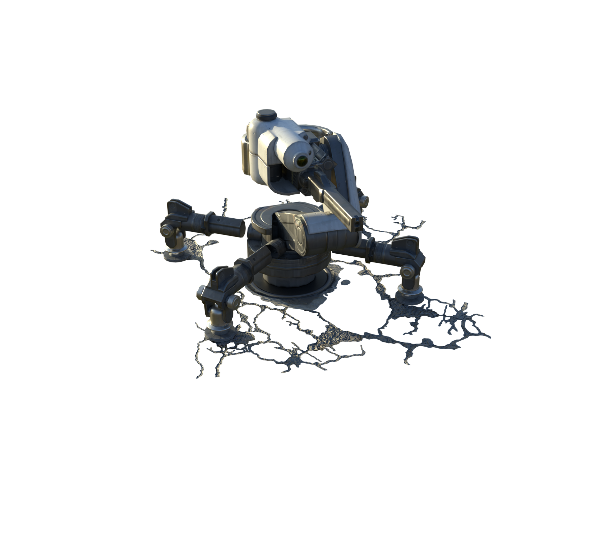
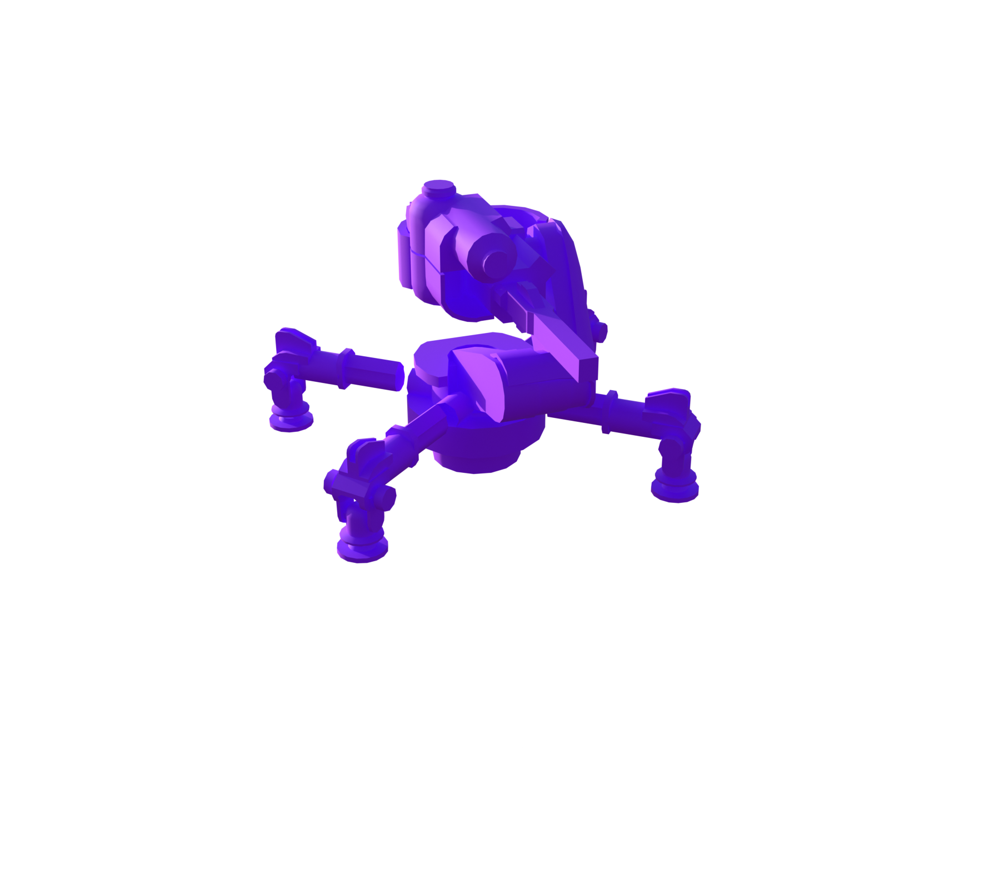
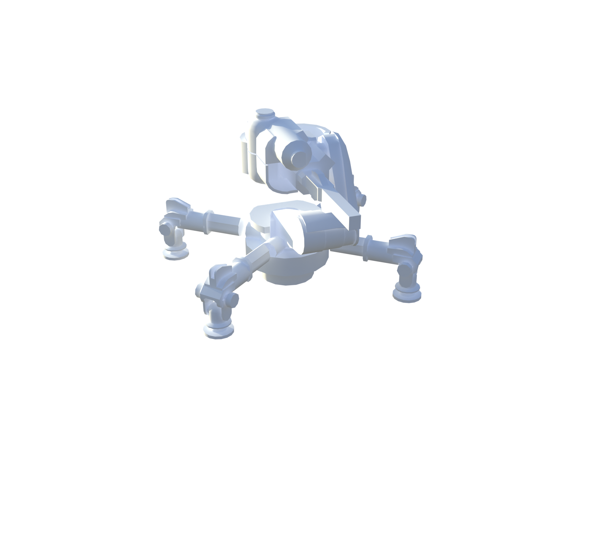
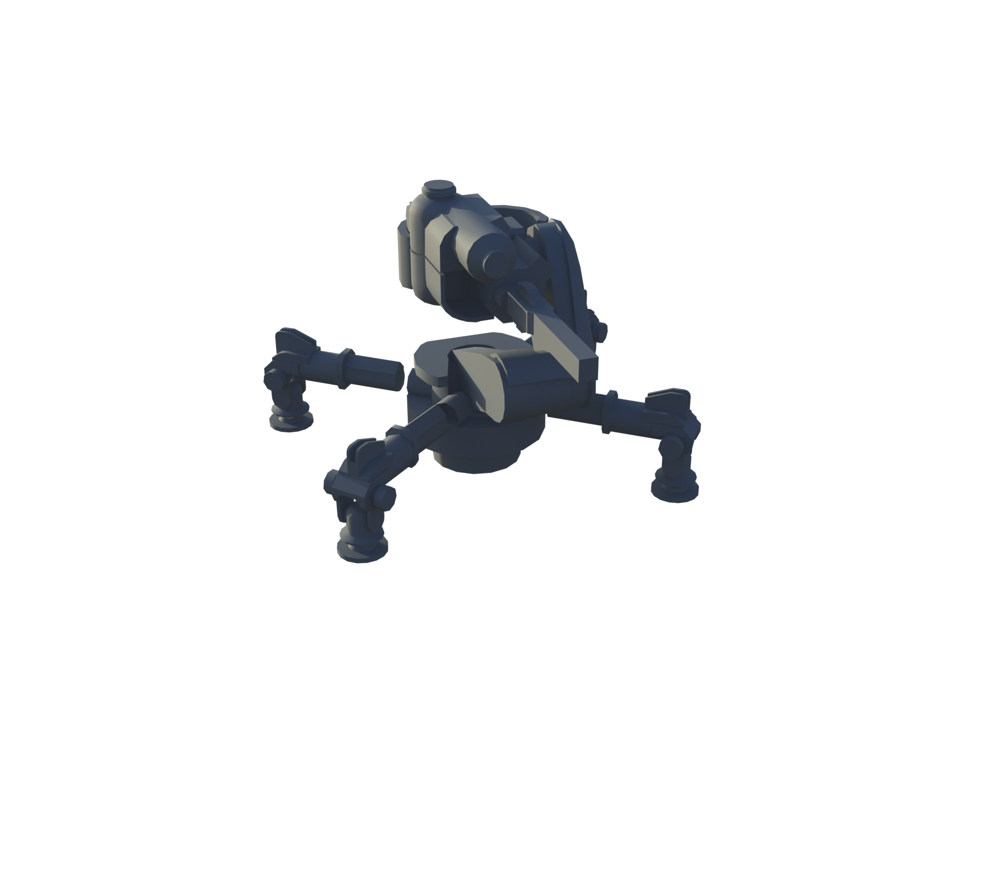
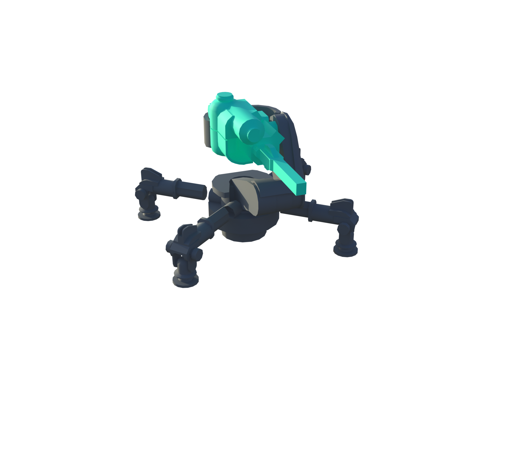
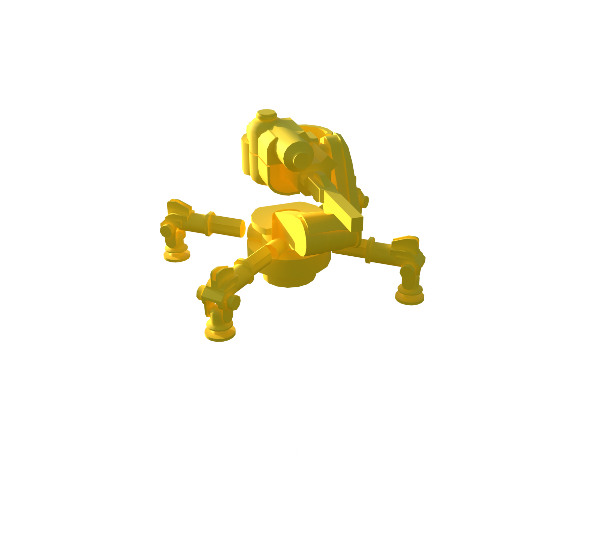

# Turret

[ARC stats](README.md) · [Machine-readable data](arc_parts.json) · [Damage model](Damage_Model.md)

**Configured frame rule:** 80 HP. **Internal class:** `C_TurretEnemy`.

Frame HP is a balancing rule, not the sum of every limb or plate. Part rules and damage propagation are separate. `—` means unknown or unassigned.

[Interactive Blender inspection model](Models/Turret.blend) · Native textures and inspector are packed into the file.

All stat renders

**Original materials**

  

**Part type**

  

**Part health**

  

**Break-off parts**

  

**Scavenging**

  

**Damage targets**

  

### Weak and critical parts

No explicit WeakPoint/Critical resistance assignment was recovered for this profile. This does not imply invulnerability.

### Every named part

These records also include sockets, bones, and proxy components; they are not all independent damageable hitboxes. The weapon’s separate ARC armor and weak-point multipliers still apply where indicated in JSON.

| Part | Configured HP | Resistance group | Physical damage × | Health rules |
| --- | --- | --- | --- | --- |
| Body_01 | 80 | Normal | 1 | 0 |
| Head_01 | 80 | Normal | 1 | 1 |
| Arm_01 | 80 | Normal | 1 | 2 |
| Laser | — | Normal | 1 |  |
| MuzzleProxy | — | Normal | 1 |  |
| StaticMeshStyle_SM_Turret_01_GroundPlanes_A | 80 | — | — | 3 |

### Exact health assignment rules

| Rule | Tag query | HP | Matched parts |
| --- | --- | --- | --- |
| 0 | ID.Frame | 80 | Body_01 |
| 1 | ID.Head | 80 | Head_01 |
| 2 | ID.Turret | 80 | Arm_01 |
| 3 | ID.GroundMounting | 80 | StaticMeshStyle_SM_Turret_01_GroundPlanes_A |

Actual game source files

- [Content/Pioneer/Enemies/Enemies_Archive/Turrets/DA_EnemyMetaData_Turret.json](../Sources/PioneerGame/Content/Pioneer/Enemies/Enemies_Archive/Turrets/DA_EnemyMetaData_Turret.json)
- [Content/Pioneer/Enemies/Turret/TurretEnemy/CSSC_TurretEnemy.json](../Sources/PioneerGame/Content/Pioneer/Enemies/Turret/TurretEnemy/CSSC_TurretEnemy.json)
- [Content/Pioneer/Enemies/Turret/TurretEnemy/CS_TurretEnemy_SK.json](../Sources/PioneerGame/Content/Pioneer/Enemies/Turret/TurretEnemy/CS_TurretEnemy_SK.json)
- [Content/Pioneer/Enemies/Turret/TurretEnemy/C_TurretEnemy.json](../Sources/PioneerGame/Content/Pioneer/Enemies/Turret/TurretEnemy/C_TurretEnemy.json)
- [Content/Pioneer/Enemies/Turret/TurretEnemy/DA_Balancing_C_TurretEnemy.json](../Sources/PioneerGame/Content/Pioneer/Enemies/Turret/TurretEnemy/DA_Balancing_C_TurretEnemy.json)
- [Content/Pioneer/Enemies/Turret/TurretEnemy/DA_EnemyType_TurretEnemy.json](../Sources/PioneerGame/Content/Pioneer/Enemies/Turret/TurretEnemy/DA_EnemyType_TurretEnemy.json)

